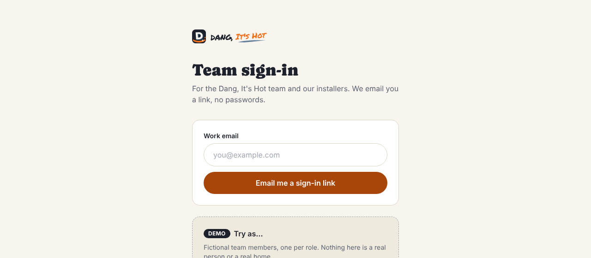
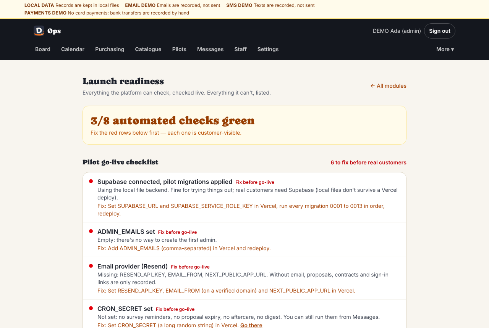
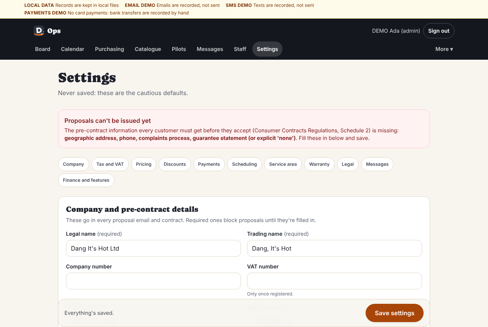
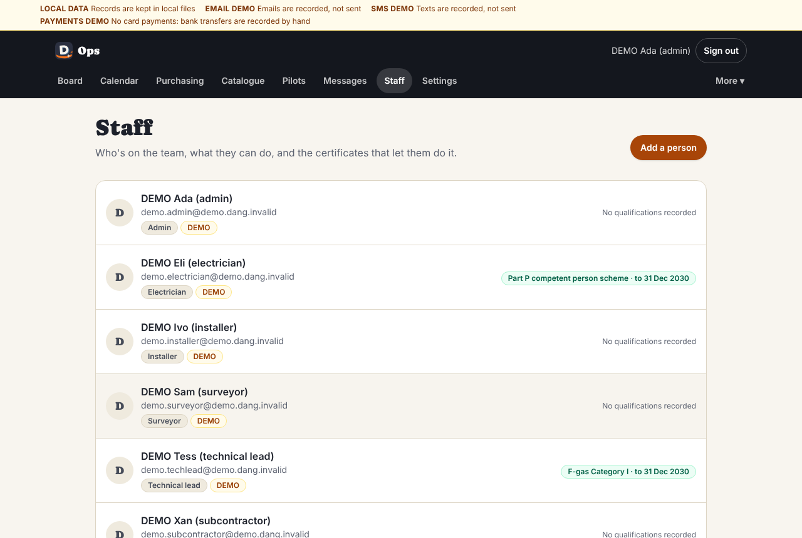
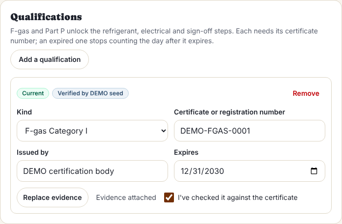
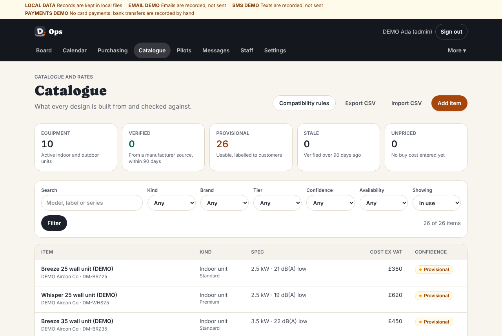
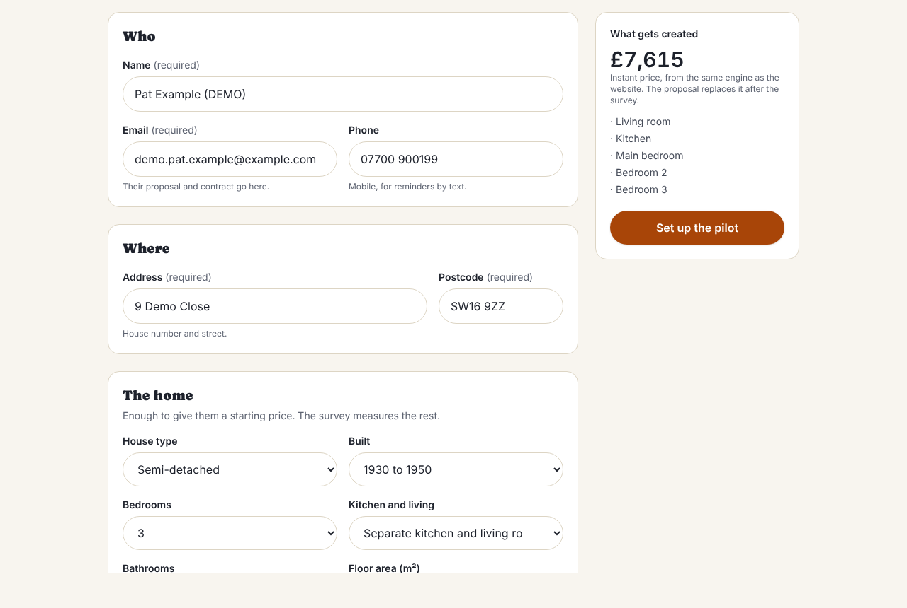
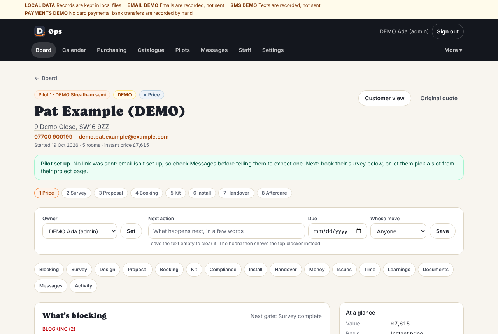
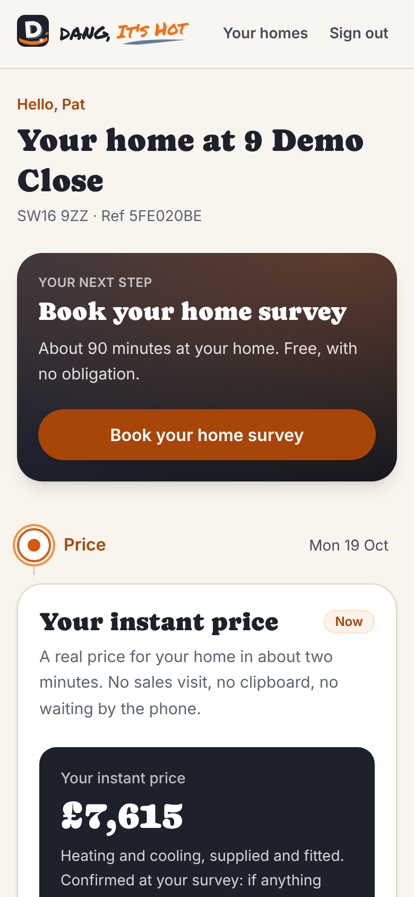

# Start here: going live with the four pilots

This is the checklist for the day you switch the pilot platform on and
start with real families and installers. Work down it in order. Each step
says how long it takes and exactly where to click.

**Total time: about half a day**, most of it typing in your company details,
your team's certificates and your supplier prices. Start step 4's email
set-up first thing: proving you own your email domain can take a few hours.

> **Privacy, always.** Real names, addresses, phone numbers and emails go
> **only** into the live app, typed into its forms. Never into GitHub,
> these documents, screenshots, chat messages to a developer, or a
> spreadsheet you share. Every picture in these guides is fictional DEMO
> data.

**Have these to hand before you start**

- Logins for GitHub, Vercel, Supabase, Resend (email) and wherever your
  domain name is registered.
- Company details: registered name, trading address (a real street address,
  not a PO box), phone, a monitored email inbox, your complaints process in
  a few sentences, bank details.
- For each person on the team: their email, mobile, role, and a photo or
  PDF of each certificate (F-gas Category I, Part P scheme membership).
- Supplier (trade) prices for the units and materials you'll fit.
- The four families' names, emails, mobiles and addresses (you'll type
  these into the app only).

**The guides behind this checklist**

| Guide | For |
| --- | --- |
| [guides/admin.md](guides/admin.md) | You, running the office side every day |
| [guides/field.md](guides/field.md) | Surveyors, installers, the electrician and the technical lead |
| [guides/customer-journey.md](guides/customer-journey.md) | What families see, and every message they get and when |
| [guides/integrations.md](guides/integrations.md) | Each outside service: what it does, where the keys come from, what it costs |
| [guides/approvals-required.md](guides/approvals-required.md) | Every legal and engineering sign-off still needed, and who gives it |
| [guides/known-limitations.md](guides/known-limitations.md) | What the app doesn't do yet, honestly |
| [guides/test-results.md](guides/test-results.md) | The latest automatic checks, with counts and dates |

---

## 1. Put the new version live (5 minutes)

The pilot platform is on a branch called `claude/pilot-ops`. Merging it into
`main` makes it the live site.

1. Go to github.com → the `air-con` repository → **Pull requests** →
   **New pull request**.
2. Set **base: main** and **compare: claude/pilot-ops**. GitHub should say
   "Able to merge".
3. Click **Create pull request**, then **Create pull request** again.
4. Click **Merge pull request** → **Confirm merge**.
5. Vercel now builds the new site by itself. Watch it: vercel.com → your
   project → **Deployments**. After 2 to 4 minutes the top entry says
   **Ready**.

Tip: you can do step 3 (the database) before this one. It only adds to the
database and the current site keeps working. Either way, do step 3 within a
few minutes of merging: until then the new site can't save anything.

If the top deployment says **Error** instead of Ready, nothing changed on
the live site. Send the developer the deployment's link (not a screenshot
with customer details).

## 2. Move Vercel to the Pro plan (5 minutes, $20 a month)

Vercel's free Hobby plan is for personal, non-commercial use, and the app
runs three scheduled jobs every day (reminders, the morning email, the
quote follow-up). A trading business needs Pro.

1. vercel.com → your team name (top left) → **Settings** → **Billing**.
2. **Upgrade to Pro**, add a card, confirm.
3. Check the plan now says **Pro**.

## 3. Upgrade the database (10 minutes)

The live Supabase database needs the pilot platform's tables (team, sign-in,
surveys, proposals, invoices and so on). One file adds them all. It's safe
to run more than once and never deletes anything.

1. Open the file `supabase/pilot-upgrade.sql` on GitHub (the repository →
   `supabase` folder → `pilot-upgrade.sql`) → click **Raw** → select all
   and copy.
2. supabase.com → your project → **SQL Editor** (left menu) → **New query**.
3. Paste, then click **Run**. If Supabase warns about a "destructive
   operation", click to confirm: one line refreshes a safety check, no data
   is touched.
4. You should see **Success. No rows returned.**
5. Check it: **New query** → paste `supabase/check-schema.sql` the same way
   → **Run**. It should say **All present**. If it names something missing,
   run the upgrade again (1 to 4), then ask the developer.

If it stops with "Two households share a pilot number": nothing changed. Give
one of the projects it names a different pilot number, then run it again.

**Projects started on the old site** stay, and show on the Board at
**Price**. An old "accepted" final quote isn't a contract here (the old site
told families it committed them to nothing, and sent none of the contract
paperwork), so you survey, design and send a proposal as for anyone. Each
one's history has an internal note, **Moved from the old system: …**, with
the old price and dates; phone anyone whose note gives an old install date.
(Known limitations 43.)

A brand-new, empty Supabase project (no quotes yet)? First run each file in
`supabase/migrations` from `0001` to `0009` the same way, in order (both
`0006` files), then the upgrade. Details: [going-live.md](going-live.md).

**The button version, for next time.** Once step 1 is done you can also
use GitHub → **Actions** → **Apply database upgrade** → **Run workflow**. It
needs a one-time secret called `SUPABASE_DB_URL`; the instructions are at the
top of `.github/workflows/apply-migrations.yml`.

**Supabase Pro ($25 a month): turn it on before the first customer photo.**
The free plan has no automatic backups, caps uploads at 50 MB and pauses a
quiet project after a week. Pro keeps 7 days of daily backups.

1. Supabase → your organisation → **Billing** → **Change plan** → **Pro**.
2. Leave the **Spend cap** switched on (it is by default): it stops surprise
   bills.
3. Note: backups cover the database, not the photo files. The app never
   deletes customer photos, so keep it that way.

## 4. Add the settings Vercel needs (30 minutes, plus email-domain waiting time)

These are the private settings the live site reads. You add each one in
Vercel → your project → **Settings** → **Environment Variables**: type the
**Key**, paste the **Value**, tick **Production**, click **Save**.

**Some of these are already there from the old site**: probably
`SUPABASE_URL`, `SUPABASE_SERVICE_ROLE_KEY`, `OPS_PASSWORD`, `EMAIL_FROM`,
`NEXT_PUBLIC_APP_URL`, `CRON_SECRET`, `LEADS_NOTIFY_EMAIL` and
`RESEND_API_KEY`. Vercel won't add a key twice, so for each one that's
already in the list: click it → **Edit** → paste the new value → **Save**.
Check each old value is real, not a template like `you@dang.ac` or
`re_xxx`. **`OPS_PASSWORD` must be a new one you generate now** (see
below): on the old site it was the shared password for the admin pages; now
it opens the whole admin console, so the old one (and the old template
`pick-something-strong`, which the app refuses) must go.

| Key | What to put | Where it comes from |
| --- | --- | --- |
| `SUPABASE_URL` | The database address (probably already there) | Supabase → **Project Settings** → **API** → Project URL |
| `SUPABASE_SERVICE_ROLE_KEY` | The database master key (probably already there) | Supabase → **Project Settings** → **API** → `service_role` key. Never email it or paste it in a chat |
| `SESSION_SECRET` | 64 random letters and numbers (see below) | You make it |
| `ADMIN_EMAILS` | Your own email address (two founders: both, separated by a comma) | You |
| `RESEND_API_KEY` | The email service key | resend.com → **API Keys** → **Create API key** |
| `EMAIL_FROM` | Who emails come from, e.g. `Dang It's Hot <hello@yourdomain.co.uk>` | A domain you've verified in resend.com → **Domains** |
| `NEXT_PUBLIC_APP_URL` | The live address with `https://` and no slash at the end, e.g. `https://dang.ac` | Your domain |
| `CRON_SECRET` | Another 64 random letters and numbers | You make it |
| `OPS_PASSWORD` | A long password, at least 20 characters. It lets you sign in on launch day while your email domain is still verifying (step 5) | You make it (see below) |

Strongly recommended: `LEADS_NOTIFY_EMAIL`, the inbox that gets team alerts
and the 6am morning email. Without it they go to the `EMAIL_FROM` address.

**Making `SESSION_SECRET` and `CRON_SECRET`.** On a Mac: open **Terminal**,
type `openssl rand -hex 32`, press Enter, copy the 64 characters it prints.
Do it twice, one for each. No Mac? Use your password manager's generator
set to 64 letters and numbers. A secret under 32 characters is ignored and
nobody can sign in. For `OPS_PASSWORD`, `openssl rand -base64 24` (or 30
characters from the password manager); keep it in the password manager. Under
20 characters it's switched off.

**Verifying your email domain in Resend** (do this first: it can take a few
hours). resend.com → **Domains** → **Add domain** → type your domain → it
shows 3 or 4 records. Add each one where your domain is registered (the DNS
settings page), then press **Verify** in Resend. When it says **Verified**,
emails land in inboxes rather than spam.

**Never add** `ALLOW_DEMO_LOGIN`, `DEMO_DEPLOYMENT`, `DATA_BACKEND` or
`LOCAL_DATA_DIR`. They're for demos on a developer's computer.

Texts (Twilio) and card payments (Stripe) are optional and can wait; see
[guides/integrations.md](guides/integrations.md).

**Then redeploy**, because settings only take effect after one: Vercel →
**Deployments** → the top entry → **⋯** → **Redeploy** → **Redeploy**. Wait
for **Ready**.

## 5. Sign in for the first time (5 minutes)

1. Go to `https://<your-domain>/login`.
2. Type one of your `ADMIN_EMAILS` addresses in **Work email** → **Email me
   a sign-in link**.
3. Open the email "Your Dang, It's Hot sign-in link" → **Sign in** → on the
   page that opens, click **Continue as …**. The link works once and lasts
   20 minutes.
4. You land on **Today**, the office home page (the **Board** is in the top
   menu). This first sign-in made your admin account. You stay signed in on
   this device for 30 days.

No email arriving? Check spam, then step 4: `RESEND_API_KEY`, `EMAIL_FROM`
and a **Verified** domain in Resend. The login page says "Email isn't set up
yet" when the keys are missing.

**Email domain still verifying? Use break-glass, then carry on.** On `/login`
click **Admin break-glass** → type your `ADMIN_EMAILS` address and the
`OPS_PASSWORD` → **Sign in**. You land on **Today**, as the admin (this also
creates your account). It lasts 12 hours and every use is logged. Do steps 6
to 10 while you wait, then sign in by email once Resend says **Verified**. The
team and the families can't sign in until email works. No **Admin
break-glass** on `/login`, or a note that it's switched off? `OPS_PASSWORD`
is missing, still a template value or shorter than 20 characters: back to
step 4, edit it to a new one, redeploy.

## 6. Make the launch checklist green (10 minutes to read; the fixes are steps 7 to 9)

Type `https://<your-domain>/ops/launch` into the address bar (it isn't in
the menu; bookmark it). The big box at the top says how many rows are left to
fix. Under it, **Pilot go-live checklist** checks everything live: red means
fix before real customers, amber means you can go ahead knowingly, green is
done. Each row has a **Fix** line and often a **Go there** link. Two rows only
appear when they matter ("Shared sign-in limits" once Supabase is connected,
"No .env.example placeholder values" if a setting still holds a template
value).

| Row | What it means | How to make it green |
| --- | --- | --- |
| Supabase connected, pilot migrations applied | The database is reachable and upgraded | Steps 3 and 4 (`SUPABASE_URL`, `SUPABASE_SERVICE_ROLE_KEY`), then reload |
| Shared sign-in limits (migration 0012) | Sign-in attempts are counted across the whole site | Step 3 (it's in the same file) |
| SESSION_SECRET set (32+ characters) | Sign-ins are securely signed | Step 4 |
| No .env.example placeholder values | A setting still holds a template value | Replace it in Vercel with a real value, redeploy |
| ADMIN_EMAILS set | There's a way to create the first admin | Step 4 |
| Email provider (Resend) | Proposals, contracts, sign-in links and updates actually go out | Step 4: `RESEND_API_KEY`, `EMAIL_FROM` (verified domain), `NEXT_PUBLIC_APP_URL` |
| SMS provider (Twilio) | Amber is fine: texts are recorded, not sent; families still get every email | Optional, see integrations guide |
| CRON_SECRET set | The daily reminders, proposal expiry, aftercare and morning email run | Step 4 |
| Pre-contract information (Schedule 2) complete | The details the law says every customer gets before they agree. **Proposals can't be issued without them** | Step 7 |
| Bank details for transfers | Invoices can say where to pay | Step 7 |
| VAT position set | Proposals show (or don't show) VAT correctly | Step 7 |
| A technical lead with a current F-gas certificate | Someone can sign designs and commissioning | Step 8 |
| An electrician with Part P scheme membership | Bookings can be confirmed | Step 8 |
| Catalogue: a priced, active unit in each tier | Standard and Quiet options can be costed | Step 9. Stays amber until you've typed your own price on at least one Standard and one Premium unit: the research's few retail prices don't count |
| Terms and cancellation wording reviewed | Amber until your solicitor has read them; proposals still go out, with a warning | Solicitor, then tick in Settings → Legal |
| No DEMO data on the live system | No demo accounts or demo projects | Should be green. If not, delete `ALLOW_DEMO_LOGIN` / `DEMO_DEPLOYMENT` in Vercel and redeploy |

Lower down, **Checked live, right now** repeats some of these, plus
"Property intelligence has data" and "Analytics receiving events". Those two
are marked **Optional** and don't matter for the pilots.

## 7. Settings: your company, money and VAT (30 minutes)

**Settings** (top menu). Work down the sections; the buttons along the top
jump to each one. Click **Save settings** (bottom right) when done, and
whenever you change anything.

1. **Company**: Legal name, Trading name, Company number, **Phone** (a real
   number: customers see it everywhere; it starts as the placeholder
   0800 000 000, which doesn't count), **Email** (a watched inbox: every
   customer email's "reply" goes here, and customers who want an early start
   reply to it; it starts as hello@dang.ac, so change it if that isn't
   watched), **Geographic address** (a real street address), **Complaints
   process** (how to complain and what happens, in plain words). If you offer
   a workmanship guarantee, **Workmanship guarantee** says its conditions and
   how to claim. Then the F-gas company certificate, insurer and policy, and
   **Bank account name, Sort code, Account number**.
2. **Review page link**: your page on an independent review site (for
   example Google or Trustpilot). Review requests only go out while this is
   set.
3. **Tax and VAT**: leave **We're VAT registered** off unless you are. Write
   one sentence in **Rationale**, e.g. "Not VAT registered; accountant to
   confirm." If you are registered: tick it, add your VAT number, pick the
   code your accountant agrees, and tick **Accountant has confirmed this**
   only when they have.
4. **Pricing**: your real day rates (installer, electrician, technical lead,
   surveyor). The defaults (£220, £250, £280, £40 an hour) are placeholders.
   Keep **A technical lead must sign off the design** on.
5. **Discounts**: `PILOT15`, `PILOT30` and `PILOTCUSTOM` are ready. Give each
   a reason; customers see the discount as its own line, taken off the real
   list price.
6. **Payments**: deposit (0% means none), when it's due, balance due days
   after handover (7). Under **Ways to pay**, untick **Card (Stripe)** until
   Stripe is set up.
7. **Scheduling**: survey times (10:00, 13:00, 16:00), survey length (90
   minutes), survey fee (£0), install block (3 days), working days, and
   **We finish within (weeks of acceptance)**: the finish-by promise that goes
   in every proposal.
8. **Service area**: the postcode districts you cover. It starts with 16
   South London districts (plus E3, in east London), including the pilot
   areas SW16, CR0, CR2 and CR8. Delete any you don't cover: the website and the New pilot form
   check postcodes against this list.
9. **Warranty**: **Workmanship guarantee (years)** (type 0 if you offer none;
   blank means "not decided") and **Manufacturer warranty summary**, as you
   have it in writing. If both are blank, proposals are blocked. Nothing
   about warranty years appears anywhere until it's set here.
10. **Legal**: leave the two "a solicitor has reviewed" boxes unticked until
    one has.
11. **Messages**: the SMS sender name (`DangItsHot`).
12. **Save settings**. The red box at the top should now be green: "All the
    pre-contract (Schedule 2) details are in."

## 8. Staff: add the team and their certificates (10 minutes a person)

The app won't let anyone sign refrigerant or electrical steps, approve a
design or sign commissioning without the right certificate on file, checked
and in date.

1. **Staff** (top menu) → **Add a person**.
2. Name (as customers will see it), Email (what they sign in with), Phone,
   a Short bio (customers see it when this person is on their crew).
3. **Roles**: tick what they do. Admin; Surveyor; **Technical lead**
   (approves designs, signs commissioning: needs F-gas); Installer;
   **Electrician** (electrical steps: needs Part P). Tick **Subcontractor**
   for anyone not on your payroll: they only ever see their own jobs, never
   prices or margins.
4. **Qualifications** → **Add a qualification**: pick **F-gas Category I**
   or **Part P competent person scheme**, type the certificate or
   registration number, who issued it, and the expiry date.
5. **Add to the team**.
6. You land on their page. Next to each qualification, **Upload evidence**
   (a photo or PDF of the certificate), tick **I've checked it against the
   certificate**, then **Save changes**. Until then the badge says "Not
   verified: doesn't count yet". (Later: **Staff** → click their name.)

Do this for yourself too (you already exist as Admin: **Staff** → your
name. The app named you after your email address, e.g. "Jo" for
jo@yourdomain.co.uk, so put your full name as customers should see it, then
your phone, bio, any other roles and your certificates), then each
installer, the technical lead and the electrician. Each of them signs in at `/login` with their own
email, the same way you did; installers land on the field app.

## 9. Catalogue: load the researched units and add your prices (30 to 60 minutes)

1. **Catalogue** (top menu). On a new site it's empty: click **Load
   researched catalogue**. This adds Panasonic, Daikin and Mitsubishi models
   with researched specs. Most are marked **Provisional**, and almost none
   has a price.
2. For each model you'll actually fit: click it, then under **Buy cost**
   type your trade price in **Cost (£ ex VAT)**, the **Supplier**, **Price
   seen on**, and a **Link to the price** or a **Note on the price**. The
   indoor and the outdoor unit are separate items and a proposal adds them
   together. If your supplier quotes the pair as one price, put about a
   quarter on the indoor unit and the rest on the outdoor unit, and say so in
   the note. The few prices already there came from public retail websites
   (some approximate): replace them with yours.
3. Under **How sure we are**: once you've checked the figures against the
   manufacturer's datasheet, set **Confidence** to **Verified**, click
   **Checked today**, and add the datasheet under **Sources**.
4. Make sure at least one priced indoor and outdoor unit is set to the
   **Standard** tier and one to **Premium** (the Quiet option).
5. **Save changes**.
6. Materials (pipe, cable, trunking, brackets): none are priced yet. Price
   the ones you use the same way, or **Export CSV**, fill in the cost column
   from your supplier's list, and **Import CSV** (it shows every change
   before saving). Excel and Google Sheets turn the dates into 18/10/2026
   when you save: that's fine, the import reads day-first dates as well as
   2026-10-18. Any unpriced line on a proposal must be typed in (or
   overridden by an admin with a reason) before it can be issued.
7. Multi-split (one outdoor unit, several rooms): only use a combination
   after checking the manufacturer's official table. **Compatibility rules**
   → the rule → mark it verified with the source.

Go back to `/ops/launch`. Once Supabase, email and `CRON_SECRET` are in,
everything should be green, apart from amber for texts (if you skipped
Twilio) and legal review (until your solicitor signs off).

## 10. Set up the four pilot households (5 minutes each)

1. **Board** → **New pilot**.
2. **Who**: Name, Email (their proposal and contract go here), Phone (a
   mobile, for reminder texts).
3. **Where**: Address and Postcode. Pilot 2: check whether it's Purley (CR8)
   or South Croydon / Sanderstead (CR2) before you type it.
4. **The home**: house type, when it was built, bedrooms, layout,
   bathrooms, fuse board (or "Not sure yet"), own or rent. It's only for a
   starting price; the survey measures everything. The family does see this
   starting price and a rough room plan on their page until the proposal
   replaces it, so get the bedrooms and layout roughly right.
5. **Pilot**: Number (1 to 4) and a **Label** that is an area or house type,
   never the address (e.g. "Owner's home", "Purley semi", "Croydon",
   "Pollards Hill"). Labels show on dashboards and exports.
6. Tick **Email them a link to their project now**. If email isn't set up
   yet, nothing goes and the app says so; send it later from the project
   (**Admin** box → **Email them a sign-in link**).
7. **Set up the pilot**. You land on the project's page ("command centre").

Then, on the project page:

8. **Owner**: it's already you (whoever set the pilot up). To hand the home
   to someone else, pick them → **Set**.
9. **Survey** box → **Book it for the customer**: day, time, In person, the
   surveyor → **Book the survey**. (Or leave it: the family can pick a slot
   themselves from their link, then assign a surveyor: **Survey** box →
   **Assign a surveyor**. Until you do, the project says **Assign a surveyor**
   under What's blocking and on the Board, Today and the morning email list
   it under **Surveys with no surveyor**, the calendar shows **No surveyor**
   on it, and the team gets one alert the working day before.)

Each family only ever sees their own home. Ticking the link box sends them
an email; nobody gets a password. To see exactly what the family sees, click
**Customer view** at the top of the project (their buttons are switched off
for you). Message previews on **Messages** never contain the real sign-in
link: it's added only as the email goes out.

## 11. What each family gets, and does next

1. **An email**: "Your link to your Dang, It's Hot project". Its **Sign in**
   button opens a page with one button, **Continue as** and their email with
   part of it hidden on purpose; they tap it and land on their project page. The link
   works once and lasts 30 days; any later email from us carries a fresh one.
2. **Their project page** shows one next step: **Book your home survey**
   (about 90 minutes, free). They pick at home or video, a day and a time, or
   see the one you booked. Under the times they can tick **I'm happy to
   receive my proposal and contract documents by email**: that records the
   documents-by-email agreement (see below).
3. **Booking confirmed** by email: date, time, what we'll check, what to
   have ready (fuse board and loft access).
4. **The day before**, around 4pm: a reminder email, and a text if texts
   are switched on.
5. **On the day**: a "your surveyor is on the way" text with an arrival
   time when the surveyor taps On my way.
6. **After the survey**: "Thanks for having us" email with the date the
   proposal will arrive (3 working days).
7. **The proposal**: an email with the design drawn on photos of their own
   rooms, the fixed price, and the legally required cancellation
   information. They **Accept**, **Ask for changes**, or wait (a reminder
   after 3 days).
8. After they accept: the contract by email, then the install dates, kit
   updates, reminders, daily updates during the install, the handover pack,
   invoices and receipts, and aftercare check-ins.

Every message, with its timing, is in
[guides/customer-journey.md](guides/customer-journey.md).

**One thing they must agree to: documents by email.** No proposal can be
issued until the family agrees to receive contract documents by email. The
surveyor asks at the survey (the **Documents by email** screen), or you
record it on the project (Proposal box → **The customer agreed to get
documents by email**, and how). The pilot has no paper route: if a family
would rather have paper, call them and talk it through; if they still want
paper, tell them honestly and close the project (see
[guides/admin.md](guides/admin.md) §3.2). Their page never promises paper
copies.

## 12. The day before the first survey or install

What the app does by itself (if `CRON_SECRET` and email are set):

| When | What | Who gets it |
| --- | --- | --- |
| Every day at 6am (7am in summer) | The morning email: today's visits, what's blocked or overdue, who owes money | Your team inbox |
| Day before a survey, about 4pm (5pm in summer) | Survey reminder: email, plus text if Twilio is on | The family |
| 3 days before an install | "Getting ready for your install": the prep list and the power-off warning | The family |
| Day before an install, about 4pm | "Your install starts tomorrow": who's coming, parking. Email, plus text | The family |
| When the crew taps On my way | A text with the arrival time (email if no mobile) | The family |

What you do the day before:

1. **Calendar** (top menu): every visit has a person on it.
2. Ask the surveyor or crew to open the job on their phone and check it's
   on their **Today** screen. Crews: open the **Job pack**, read the RAMS and
   tick **I've read the RAMS and the risks**.
3. The next morning, **Messages**: the reminder shows **Sent**, not
   **Failed**. If the daily jobs haven't run, **Run daily jobs now** on the
   Messages page is safe: nothing is ever sent twice.
4. For an install: the booking is **Confirmed**, the kit is **Delivered**
   and **Checked**, and the project's checklist (**Compliance**) is approved.

## 13. If something goes wrong

**Is the site healthy?**

- `https://<your-domain>/ops/status`: every table, file store and setting,
  with what each is for. `/ops/launch`: the go-live checks.
- `https://<your-domain>/api/health` should say `"status":"ok"`.
- Vercel → **Deployments** (is the top one Ready?) and **Logs** (error
  messages). Supabase → **Project** home page (is it paused or unhealthy?).

**Who to contact**

| Problem | Who |
| --- | --- |
| The site is down or erroring | Your developer (whoever looks after this GitHub repository); Vercel support (vercel.com/help, Pro plan) |
| The database is down or paused | Supabase → **Support** (in the dashboard) |
| Emails not arriving | Resend → **Emails**: find it and read its status; then Resend support |
| Texts not arriving | Twilio console → **Monitor** → **Logs** |
| Card payment questions | Stripe dashboard → **Payments** |
| A customer emergency (gas, electric shock, fire) | 999 first, always |

Never send a developer a screenshot or log containing a customer's name,
address, phone or email. Send the project's reference (e.g. "Ref AB84A440")
instead.

**Resend a message.** **Messages** → filter by the family or the message
type → open the message → **Retry** (if it failed) or **Send again** (if it
went but they can't find it). Fix a wrong email or mobile first (below):
**Retry** and **Send again** always go to the email or mobile on the
project *now*, never the old one, and say so ("Sent to … , the address on
the project now"). A message still waiting for the old address stops
trying it and goes to the new one by itself; if you removed the address,
nothing goes.

**A family's link has expired.** The project → **Admin** box → **Email them
a sign-in link**. Or ask them to open your site's `/portal` page, type their
email and press **Email me a sign-in link**. Or resend any recent message:
every email carries a fresh link.

**Fix a wrong entry**

| Wrong | Where to fix it |
| --- | --- |
| Name, address, postcode, email, phone, access or parking notes | The project → **Admin** box → **Edit contact and access**. Changing the email moves access to the new address. A corrected name or address is used from then on; documents already issued keep the details they went out with |
| The email was wrong when the proposal went | Correct it as above, then once the family has agreed to documents at the new address (their page asks), **Messages** → the proposal email → **Send again**. Until it has gone to the new address they can't accept |
| Pilot number or label | The project → **Change pilot tag** |
| Survey time or surveyor | The project → Survey box → **Move the survey** / **Change surveyor** |
| Install dates or crew | The project → **Booking** → move the dates or change the crew (the family is told) |
| A proposal before it's accepted | The project → **Proposal** → **Revise: start version 2**, fix it, issue it. It replaces the old one for the family |
| A proposal after it's accepted | It can't be edited (it's the contract). Use a variation: the family approves the change and its price |
| A payment recorded wrongly | The project → **Money** → **Record a refund** or a credit note. Payments are never deleted, so the history stays true |
| A card payment refund | In Stripe's dashboard. The app records it by itself; don't record it by hand as well |
| Company details, prices, rates | **Settings** → change → **Save settings**. Proposals already sent keep the terms they went out on |
| A certificate number or expiry | **Staff** → the person → edit → **Save changes** |
| A catalogue price | **Catalogue** → the item → **Save changes** |
| An issue closed by mistake | The project → **Issues** → **Reopen** |

Closing a project can't be undone on screen: only **Close the project** once
it's paid, the warranty is registered, the electrical certificate is in and
no serious defect is open.

**Data lost or broken, and it can't be fixed on screen?** Restoring a
backup puts the whole database back to that day, losing everything since:
follow [guides/admin.md §11 Restore from backup](guides/admin.md#11-restore-from-backup)
step by step, and ask your developer first.

**A family asks what we hold, to correct it, or to delete it** (a
data-protection request): reply within a month, following
[guides/admin.md §12](guides/admin.md#12-data-protection-requests-access-correction-deletion).
Never delete a project row in Supabase to "remove" someone: it deletes its
invoices and payments with it. Take legal advice first.

---

> ### What it costs per month
>
> | Service | Plan | Per month |
> | --- | --- | --- |
> | Vercel (the website) | Pro | $20 |
> | Supabase (database, photos, backups) | Pro | $25 |
> | Resend (email) | Free: 3,000 a month, 100 a day | $0 |
> | Twilio (texts), optional | Pay as you go, about 60 texts | up to about $5 (price not verified) |
> | GitHub (code, daily health check) | Free | $0 |
> | **Total** | | **about $45, plus texts (≤ $50)** |
>
> Not included: card fees if customers pay by card (Stripe's UK rate was not
> verified; roughly £45 on a £3,000 payment, so bank transfer is the default
> for balances), your domain name, and any UK VAT added to these bills.
> Details: [research/services-and-costs.md](research/services-and-costs.md).

> ### What still needs a professional
>
> - **Solicitor**: the terms, the cancellation wording and the model
>   cancellation form (reconstructed, not copied from the official text),
>   whether an early-start request on our web page is enough, how a
>   cancellation after installation is handled, and the complaints / ADR
>   wording.
> - **Accountant**: whether to register for VAT, and whether air-to-air
>   heat pumps can be zero-rated before 1 April 2027 (5% after).
> - **F-gas company certificate** (REFCOM or another approved body): the
>   business needs one, as well as each engineer's Category I.
> - **Electrician's competent person scheme** (NICEIC, NAPIT or similar):
>   for the new circuit's certificate and Building Regulations notice.
> - **Manufacturer accreditation**: extended warranties usually need an
>   accredited installer and registration within a deadline.
> - **Insurance**: public liability and contractors' all-risk, before the
>   first survey.
>
> The full list, with why and who: [guides/approvals-required.md](guides/approvals-required.md).
