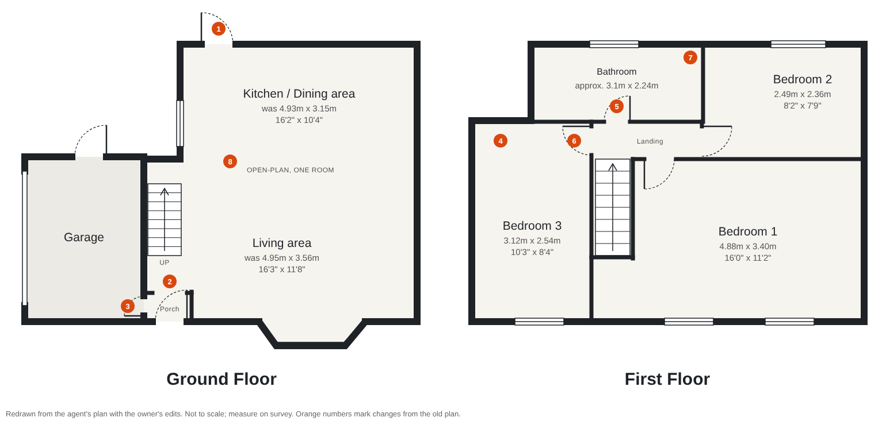
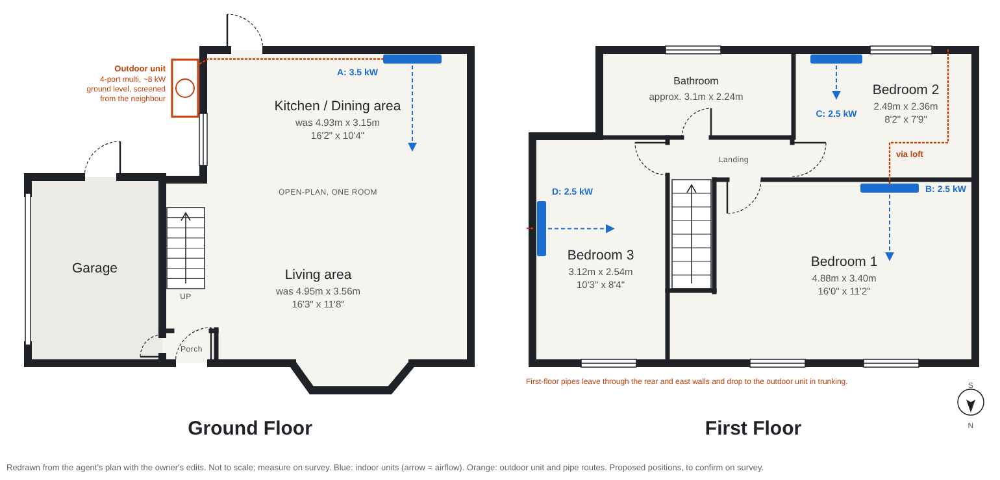

# Case study 01: three-bed semi with garage

The first property used to work out the internal process from a quote
request to a fitted system: how many indoor and outdoor units, the output
each room needs, and where each unit goes.

## Step 1: current floor plan

Redrawn from the estate agent's plan (Benson & Partners) with the owner's
mark-up applied. The agent's plan is not to scale, so room sizes here are
the agent's figures and are measured again on survey before any sizing.
Regenerate the drawing with `python3 floor-plan.py floor-plan-current.svg`.

| Floor  | Room             | Agent's size    |
| ------ | ---------------- | --------------- |
| Ground | Open-plan kitchen, dining and living (one room) | was 4.93m x 3.15m (kitchen) + 4.95m x 3.56m (living) |
| Ground | Garage           | not given       |
| First  | Bedroom 1        | 4.88m x 3.40m   |
| First  | Bedroom 2        | 2.49m x 2.36m   |
| First  | Bedroom 3        | 3.12m x 2.54m   |
| First  | Bathroom         | approx. 3.1m x 2.24m (extended; agent's 2.26m x 2.24m was before) |

### Changes from the old plan (orange numbers on the drawing)

1. The lean-to at the back is gone. The kitchen's back door now opens
   straight outside.
2. The inner porch door into the living room is gone; the porch is open to
   the living room.
3. New door from the porch into the garage.
4. The small lobby in front of Bedroom 3, and its door, are gone. The lobby
   space is now part of Bedroom 3.
5. The bathroom door now opens off the landing.
6. Bedroom 3's door now opens off the landing, in its right-hand wall.
7. The bathroom's right-hand wall was knocked down and the bathroom now
   runs over the old cupboard, up to a new wall against Bedroom 2. Its new
   width (about 3.1m) is scaled from the old plan and needs measuring.
8. The wall between the living room and the kitchen/dining room is gone.
   The ground floor (apart from the garage and porch) is one open-plan
   room, with the stairs rising inside it. It is sized as one space.

The owner has confirmed this layout, including Bedroom 2's door at the
end of the landing.

## Step 2: sizing and unit positions

### What we know

- Garden faces south, so the front (bay window, Bedrooms 1 and 3) faces
  north and the garage side faces east.
- Ceilings about 2.5m.
- Cavity walls with no insulation (U about 1.5 W/m²K).
- Loft insulation is poor (assumed U 0.5 W/m²K, about 75mm).
- Assumed, to confirm: older double glazing; semi-detached, joined to the
  neighbour on the west wall (it has no windows on either floor); window
  sizes scaled from the plan.

### Room loads

Worked out in `sizing-check.py`. Cooling design day: 30°C outside, 24°C
inside, loft at 40°C. Heating design day: -3°C outside, 21°C in the
open-plan room, 18°C in bedrooms.

| Room                 | Area   | Cooling need | Heating need | Indoor unit |
| -------------------- | ------ | ------------ | ------------ | ----------- |
| A: Open-plan ground  | 33.1m² | 3.0 kW       | 2.7 kW       | 3.5 kW      |
| B: Bedroom 1 (north) | 16.6m² | 0.8 kW       | 0.9 kW       | 2.5 kW      |
| C: Bedroom 2 (south) | 5.9m²  | 0.7 kW       | 0.4 kW       | 2.5 kW      |
| D: Bedroom 3 (north) | 7.9m²  | 0.6 kW       | 0.7 kW       | 2.5 kW      |
| Whole house at once  |        | 5.0 kW       | 4.7 kW       |             |

- The open-plan room is the only one where size is a real choice. Kitchen
  heat, four people and the sun on the rear wall make up most of its load.
  If the rear wall now has patio or bifold doors where the lean-to was, its
  cooling need rises to about 4.1 kW and unit A becomes 5.0 kW.
- 2.5 kW is the smallest common wall unit, so every bedroom gets one even
  though they need less. Inverter units turn down, so this is fine. Some
  ranges offer 2.0 kW multi-split heads for Bedrooms 2 and 3.
- Bedroom 2 needs more cooling for its size than any other room: it is small
  and its window faces south.
- The uninsulated walls make heating loads high for the floor area. Filling
  the cavity and topping up the loft would cut both loads and running costs.
  It is worth telling the customer before they buy.

### One outdoor unit

Planning permitted development (England, Class G) allows only one outdoor
unit on a house that is not detached. So all four rooms run from one
4-port multi-split outdoor unit, about 8 kW (connected indoor total 11 kW;
check the manufacturer's combination table). Permitted development also
requires the system to be used for heating, not only cooling.

### Where the units go

- **Outdoor unit:** ground level in the side return, on the kitchen's east
  wall. The house sits between it and the neighbour's windows, which helps
  the noise check (MCS 020(a): no more than 37 dB(A) from the unit at the
  neighbour's nearest window). The noise check needs the chosen model's
  sound power and the measured distance. A second option is the rear wall
  next to the back door.
- **A, open-plan:** high on the rear wall, right of the back door, blowing
  along the room's length toward the bay window. Short pipe run along the
  wall to the outdoor unit. Keep it away from the hob.
- **B, Bedroom 1:** high on the wall shared with Bedroom 2, blowing toward
  the windows. Pipes go up into the loft and out through the rear, which
  keeps them off the front of the house. It needs a condensate pump.
- **C, Bedroom 2:** high on the rear wall, left of the window. Pipes go out
  through the wall and down the rear elevation in trunking.
- **D, Bedroom 3:** high on the east wall, blowing across the room. Pipes go
  out through the east wall and down to the outdoor unit.
- Estimated pipe runs: A 3m, B 11m, C 8m, D 7m, about 29m in total. That is
  within a typical 4-port unit's limits.

### What the platform's quick quote engine says for this house

Run through `designSystem` in `packages/domain` with the same rooms, it
proposes a 7.1 kW unit for the open-plan room and **two** outdoor units (an
8.0 kW 4-port and a 5.2 kW 2-port). On a semi-detached house that breaks the
one-unit permitted development limit, and the engine only flags it as
"worth an engineer's eye on positioning". The engine also uses a fixed
2.4m ceiling and has no input for wall or loft insulation. A follow-up is
to make it respect the one-unit limit for non-detached houses.

### To confirm on survey

- What is on the rear wall now that the lean-to has gone: a door, a window,
  or patio doors?
- Where the hob and cooker are.
- Is Bedroom 3 over the garage?
- Is the house semi-detached, joined on the west wall?
- Window sizes, and whether they are double glazed.
- Fuse board: spare ways, and its condition.
- The distance from the outdoor unit position to the neighbour's nearest
  window.
