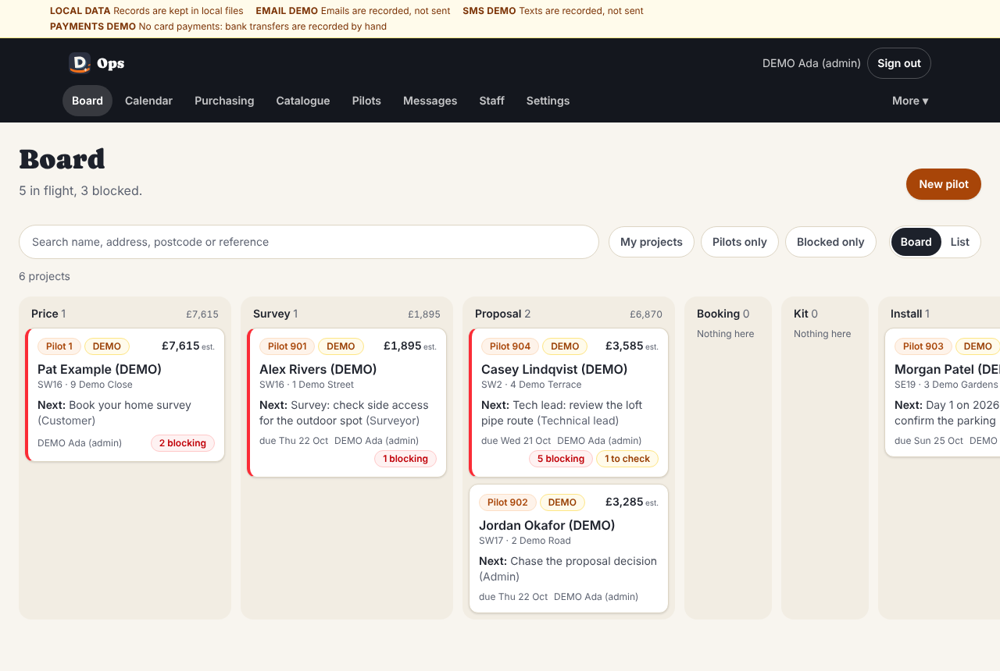
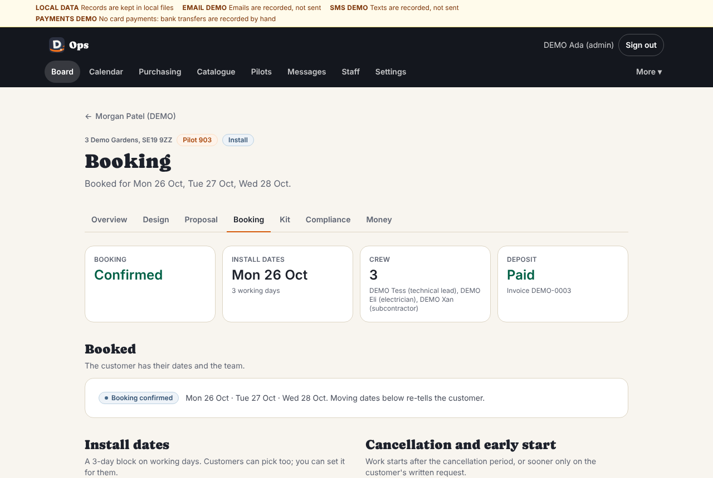
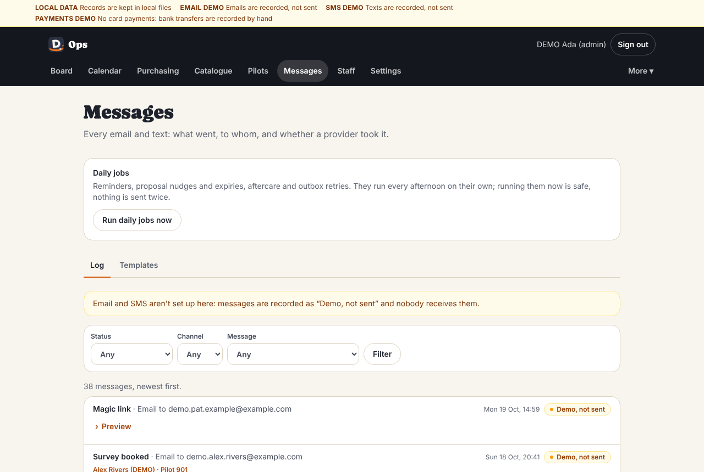

# Admin guide: running the pilots from the office

For the owner, and anyone with the **Admin** role. It follows a job from
the first click to the last payment, then covers the weekly review and the
settings. The app's own short version is **More → Help: daily routine**
(`/ops/help`); this is the longer one.

Setting the site up for the first time is in
[../START-HERE-TOMORROW.md](../START-HERE-TOMORROW.md). Every picture here
is fictional DEMO data.

## Contents

1. [Your screens](#1-your-screens)
2. [Every morning](#2-every-morning-15-minutes)
3. [A job, start to finish](#3-a-job-start-to-finish)
4. [Money](#4-money)
5. [Cancellations, problems and changes](#5-cancellations-problems-and-changes)
6. [Every Friday: the pilots review](#6-every-friday-the-pilots-review-30-minutes)
7. [Messages](#7-messages)
8. [The team](#8-the-team)
9. [Settings and the catalogue](#9-settings-and-the-catalogue)
10. [Who can do what](#10-who-can-do-what)

---

## 1. Your screens

The dark bar along the top of every office page:

| Menu | What it's for |
| --- | --- |
| **Board** | Every project, in columns by stage. Red "blocking" counts mean something is stopping it. **New pilot** is here |
| **Calendar** | Who is where, on which day: surveys and install days |
| **Purchasing** | Every purchase order across all jobs |
| **Catalogue** | Units and materials, with prices and how sure we are of the figures |
| **Pilots** | The pilots side by side: price, cost, hours, margin, what we learned. CSV download |
| **Messages** | Every email and text: what went, to whom, and whether it arrived at the provider |
| **Staff** | The team and their certificates |
| **Settings** | Company details, VAT, prices, payments, scheduling, legal |
| **More** | Console, Quotes (website enquiries), Intel and Analytics (marketing), Finance (business plan), **Status** (is everything working?), **Help: daily routine** |

Two pages aren't in the menu; bookmark them: **`/ops/launch`** (the go-live
checklist) and **`/ops/status`** (health of every table, file store and
setting).

The coloured strip at the very top says if anything is in demo mode
("EMAIL DEMO: emails are recorded, not sent"). On the live site with
everything set up, it shouldn't be there.

After you save something, the page updates itself. If it ever says
**"Saved, but this page hasn't caught up with it yet"**, the save worked:
tap **Show the latest** before doing anything else on that page (its
button waits until you do, so a payment can't be recorded twice against a
page that still shows it owed).

### The project page ("command centre")

Click any card on the Board. One page has everything about that home:

- **The stage strip** (1 Price → 8 Aftercare) and **Customer view** (see
  exactly what the family sees).
- **Owner / Next action / Due / Whose move**: who's responsible and what's
  next. The Board shows the next action on the card. Leave it empty and the
  card shows the top blocker instead.
- **What's blocking**: the next gate (for example "Survey complete") and
  each thing stopping it, with who has to act and a link.
- One box per stage: **Survey, Design, Proposal, Booking and crew, Kit,
  Compliance, Install, Handover, Money**, each with its main button.
- **Issues, Time, Learnings, Documents, Messages, Activity**: the history.
- **Admin** box: internal note, **Change pilot tag**, **Edit contact and
  access**, **Email them a sign-in link** (a fresh link to their project
  page, to the email on the project), **Close the project**, **Record a
  cancellation**.

## 2. Every morning (15 minutes)

1. Read the morning email (6am in winter, 7am in summer): today's visits,
   what's blocked or overdue, who owes money.
2. **Board** → **Blocked only**. Open each red card, read **What's
   blocking**, and either do the next action or give it an owner and a date.
3. Then the cards whose next action is due today.
4. **Calendar**: every survey and install day today has a person on it.
5. **Messages** → Status **Failed** → **Filter**. Open each one, fix the
   address or number (see §5), then **Retry**.
6. Any issue or variation the crew raised yesterday: the project →
   **Issues**. Answer questions; check the price of a variation before it
   goes to the family.

## 3. A job, start to finish

### 3.1 New pilot (5 minutes)

**Board** → **New pilot**. Type the family's name, email and mobile, the
address and postcode, a few facts about the home (for a starting price),
the pilot **Number** and a **Label** (an area or house type, never the
address). Tick **Email them a link to their project now** → **Set up the
pilot**.

Then on the project page: **Owner** → yourself → **Set**.

A postcode outside the service area gets a warning, not a refusal; add the
area in **Settings → Service area** if you now cover it. Two pilots can't
share a number: the form says which household already has it.

### 3.2 The survey

- The family picks a slot from their page, or you book it: **Survey** box →
  **Book it for the customer** → day, time, **In person** or **Video call**,
  surveyor → **Book the survey**. They get a confirmation email straight
  away and a reminder the day before.
- To change it: **Move the survey** or **Change surveyor** (the family is
  told).
- The surveyor works on their phone (see [field.md](field.md)) and submits.
  The project moves to Design. **Customer's own survey vs measured** shows
  how the family's own answers compared with what was measured: the most
  useful thing the pilots will teach us.
- **Documents by email**: the surveyor asks before leaving. If they didn't,
  record it yourself in the **Proposal** box (**The customer agreed to get
  documents by email**, and how: in person, or by email with its date and
  subject). No proposal can be issued without it.

### 3.3 The design (technical lead)

The project → **Start the design** (or **Open the design**) → **Draft the
design**. It is drafted from the measured survey and the catalogue.

- **Checks** at the top: each rule is a pass or a **CHECK** with the
  reason: planning constraints, noise at the nearest neighbour, mounting,
  access, catalogue data. They're for the engineer's eye, not decisions.
- **Rooms**: the suggested size ("rule-of-thumb estimate for review, not a
  heat-loss calculation"), the size picked, condensate, pipe run, the indoor
  unit for each option, and **tick the photos that form the approved
  layout**. Changing a measured figure asks why.
- Multi-split (several rooms on one outdoor unit) only from a combination
  the catalogue lists as checked.
- A surveyor can draft and **Submit for review**; only a technical lead with
  a current F-gas certificate can **Approve and sign**. Signing locks the
  layout photos the installers will work from.

### 3.4 The proposal

The project → **Build the proposal** → **Start the proposal**.

1. One option, or two (Standard and Quiet). Each shows the **list price**
   (the pricing engine on the surveyed design), **Our cost** (equipment and
   materials from the catalogue, labour days at your rates, delivery,
   contingency) and the **Gross margin**.
2. Any cost line without a price must have one typed in, or an admin
   override with a reason. Never guess: ask the supplier.
3. **Pilot discount** with its reason (shown to the family as its own
   line), the tax code, and **Valid until**.
4. A price above their online estimate needs **Why it's more than the
   online estimate**, in words they'll understand ("you added a room").
5. The panel on the right lists anything stopping it under **Before it can
   go**: Schedule 2 settings, documents-by-email agreement, design signed,
   email working, margin below the minimum (an admin can override, with a
   reason).
6. **Issue proposal**. It emails the family their proposal, the
   pre-contract information and the cancellation form.

Issued versions never change. To change one before it's accepted: **Revise:
start version 2**, edit, issue; it replaces the old one for the family.
The family can **Accept**, **Ask for changes** (you get an email with what
they said) or let it run out. They get one reminder after 3 days; it expires
on its date.

### 3.5 Acceptance and the early start

The family accepts on their page by choosing an option, reading the
cancellation information, and typing their name. They get the contract by
email straight away.

**The 14-day cancellation period.** Because we supply the equipment, the
period runs until 14 days after the last of it arrives. We don't start
inside it unless the family **asks in writing**. If they ticked "start
within my cancellation period", their page asks them to reply to the
contract email with exact words. When that reply arrives:

1. The project → **Booking and crew** box → **Record their early-start
   email or form** → **It came as**: **Their email**.
2. Upload their email (saved as a PDF or a screenshot), type its date and
   subject under **Which one**, tick that it asks us to start early in the
   words we gave them, check **From** is their address → **Record**. An
   email from any other address is refused. (A signed paper form works too:
   pick that instead and upload a photo of it.)

Without that, the booking page only offers dates after the period ends.

### 3.6 Booking

The project → **Dates, crew and deposit**.

1. **First install day** → **Set install dates** (a block of working days;
   3 by default).
2. **Who's on the job**: tick the installer, the technical lead and the
   electrician → **Save the crew**. It checks each person's certificates
   against the last install day and says whether F-gas, Part P and a
   technical lead are covered.
3. **Deposit** (if Settings asks for one): **Send the deposit invoice**;
   record the payment when it arrives (§4).
4. **Confirm booking and tell the customer**. They get their dates, the
   team and the prep list.

Moving dates later (**Move the install**) tells the family again.

### 3.7 Kit

The project → **Kit** (or **Raise purchase orders** on the command centre).

1. **Raise purchase orders**: made from the approved design, one per
   supplier.
2. **Approve to order** → place the order with the supplier (phone or their
   website) → **Mark as ordered** → when they give a date, **Supplier
   confirmed a date** → **Mark as dispatched** when it's on its way.
3. **Record a delivery** when it arrives: who took it in → **Save the
   delivery**. The family is told when the supplier confirms, when it's
   delivered, and when it's checked; never on an estimate.
4. **Check the kit against the design**: serial numbers → **Save the
   check**. (The installer can do this on site on day 1 instead.)
5. Afterwards: type what the supplier actually charged → **Save actual
   costs**, so the margin on the Pilots page is real.

### 3.8 Compliance checklist

The project → **Open the checklist**. Twenty items, each with its gate
(before the proposal, before booking, before install day, before closing).
**Statutory** items can't be overridden. The technical lead reviews each
(**Review** → Approve or Not applicable, with a note → **Save the
review**). Some update by themselves (the design sign-off, the electrical
certificate). Everything for install day must be approved before the crew
can start.

### 3.9 Install days

- **Calendar** shows who's where. The crew's "on my way" text shows in the
  project's **Messages**.
- During the day the **Install** box shows the runsheet's progress, the
  photos and any issues. A blocking issue holds the job: answer it fast.
- **A variation** (extra work): the crew sends it to you with an estimate.
  Check the price → **Send to the customer for their OK**. The family
  approves or declines on their page. Tell the crew not to start until it
  says approved.
- In the evening the installer's end-of-day update (with the photos they
  picked) goes to the family; you'll see it under the project's Messages.
- Last day: the technical lead sets the job's test targets from the
  manual, reviews anything flagged **Needs review**, and signs
  commissioning on site.

### 3.10 Handover

- Once commissioning is signed the crew publishes the family's **handover
  pack** (equipment, serials, commissioning certificate, manuals, care
  guide, contacts), walks them through it, and the family signs **All
  good** or **There's a snag**. Each snag becomes an issue with an owner and
  a date; the family can see it.
- **Handover** box → **Electrical certificate received**: upload it,
  certificate number, issued by → **Add to their documents**. Or mark it
  pending from the scheme. The law gives 30 days; the team gets a weekly
  alert while it's overdue.
- **Warranty registered**: register with the manufacturer (the box shows
  the date to register by, 30 days after handover), then type the
  registration reference → **Add to their documents**.

### 3.11 Closing

**Close the project** (Admin box) once: the balance is paid, the warranty is
registered, the electrical certificate is in, and no serious defect is open.
The page warns you about anything still open. Closing can't be undone on
screen. Aftercare messages carry on by themselves after closing.

## 4. Money

The project → **Invoices and payments** (the Money page).

- **The balance** follows the contract's terms: offered once the
  installation is finished → **Issue and email**. (An admin can bill it
  early, with a reason.)
- **A bank transfer**: only once you can see it in the bank account →
  **Record a payment you've seen** → the reference on the statement → **Record
  the payment**. Never before. The family gets a receipt.
- **Card payments** (if Stripe is set up) record themselves from Stripe.
  **Refund a card payment in Stripe's dashboard**: it's recorded here by
  itself, with a credit note. Don't record it by hand as well (the app
  refuses).
- A wrong amount or a refund by bank transfer: **Record a refund**, or a
  credit note. Payments are never deleted, so the history stays honest.
- Bank details: families only ever see them on their project page and the
  invoice. Never change them because an email asks; tell families you'll
  never ask them to pay a different account by email.

## 5. Cancellations, problems and changes

**A family cancels.** Any clear statement counts: email, letter, call,
their project page. Admin box → **Record a cancellation**: the date (and
time if known) it reached us, how, and where it's on file → **Record the
cancellation**. The project closes as cancelled, unpaid invoices are
voided, refund and collection tasks are raised, and the family gets an
acknowledgement. The refund is due within 14 days of the day it reached us.
Once it's recorded, nothing more can be invoiced on the project: only
refunds and credit notes. The family's page says the contract is
cancelled (with the refund and its date), and the install, handover and
aftercare stages show as cancelled.

If it reached us **after the cancellation period ended**, the form warns
you before you record it. Then the family is only told we've received it
and will be in touch in writing: no refund or collection is promised, and
instead of the refund task you get one to take advice first, then write to
them.

**Fixing wrong details**

| Wrong | Fix |
| --- | --- |
| Name, address, postcode, email, phone, access, parking | Admin box → **Edit contact and access** → **Save contact details**. A new email moves their access to that address. A corrected name or address is used from then on; documents already issued keep the details they were issued with |
| An email that was wrong when the proposal went | Correct it as above. The proposal email to the old address no longer counts, so they can't accept until they've agreed to documents at the new address (their page asks) and you've pressed **Send again** on the proposal email in **Messages** |
| Pilot number or label | **Change pilot tag** |
| Survey time or surveyor | Survey box → **Move the survey** / **Change surveyor** |
| Install dates or crew | **Booking** → **Move the install**, or change the crew and **Save the crew** |
| A proposal not yet accepted | **Revise: start version 2** |
| A proposal already accepted | It's the contract: use a variation (the family approves the change and its price) |
| A payment | **Record a refund** or a credit note |
| An issue closed by mistake | **Issues** → **Reopen** |

**Resending a message**: **Messages** → open it → **Retry** (failed) or
**Send again** (sent). It goes to the email or mobile on the project now:
after you correct a wrong address, the message goes to the new one (shown
as a new row), never again to the old one. A family whose sign-in link has run out can ask for
a new one on your site's `/portal` page; every email we send also carries a
fresh one.

## 6. Every Friday: the pilots review (30 minutes)

1. **Pilots**: each pilot side by side. Instant price against list and
   final, costs, hours against the estimate, margin, defects, how happy the
   family is.
2. Each job's **Kit** page: actual supplier costs typed in and saved. Its
   **Time** page shows the hours the crew logged (Arrived, Pause, End day),
   plus anything added by hand.
3. Read the week's end-of-day answers (**Learnings** on each project): what
   took longer, what was missing, what confused the family.
4. Pick one to three changes (a checklist step, a catalogue price, a survey
   question, a day rate) and make them before Monday.
5. **Download CSV** from Pilots and keep it.
6. `/ops/launch` is still green (a certificate may have expired).

## 7. Messages

**Messages** lists every email and text, newest first, with filters for
status, channel and message type.

- **Sent**: the provider (Resend or Twilio) accepted it. **Demo, not sent**:
  that channel isn't set up (texts, until Twilio is). **Failed**: open it to
  see why. **Skipped**: deliberately not sent (for example, a family who
  stopped follow-up emails).
- **Preview** shows exactly what went, except the sign-in link itself: it's
  added only as the email goes out and is never stored, so a preview can't
  open it. To see a family's page, use the project's **Customer view**; to
  send them a new link, the project's **Admin** box → **Email them a sign-in
  link**.
- **Templates** tab: switch a message type off if you need to. Three can't
  be: the sign-in link, the proposal email and the contract confirmation
  (the law needs the last two to reach the family).
- **Daily jobs**: reminders, proposal nudges and expiries, aftercare and
  retries run every afternoon by themselves. **Run daily jobs now** is safe
  at any time: nothing is ever sent twice.

## 8. The team

**Staff** → **Add a person**, or click someone to edit them.

- **Roles** decide what they can do (§10). **Subcontractor** means they
  only see the jobs they're on, never prices, margins or other families.
- **Qualifications**: F-gas Category I, Part P scheme, 18th Edition, PASMA,
  IPAF, asbestos awareness, first aid. Each needs its number and expiry;
  then **Upload evidence** and tick **I've checked it against the
  certificate**. Until both are done it doesn't count anywhere.
- The list warns when a certificate has expired or expires within 60 days.
  An expired one stops counting the day after it expires.
- Someone leaving: untick **Active** → **Save changes**. They can't sign
  in; their past work keeps their name.
- People sign in at `/login` with the email on their record. Sessions last
  30 days on each device.

## 9. Settings and the catalogue

**Settings** holds every business decision that isn't code. Change a field
→ **Save settings**. Proposals already sent and contracts already made keep
the terms they went out on.

Worth knowing:

- **Phone** and **Email** appear on every message and document; the email
  is where families' replies go, so it must be a watched inbox.
- **Proposal valid for (days)**, **Minimum margin (%)**, **Contingency
  (%)**, day rates.
- **Deposit (%)** (0 = none), **Deposit due**, **Balance due (days after
  handover)**, **Ways to pay**, **Next invoice number** (only ever raise
  it).
- **Survey slot times**, **Install block (days)**, **Working days**, **We
  finish within (weeks of acceptance)**.
- **Service area**: postcode districts. The website's quote form and the
  New pilot form both check against it.
- **Warranty**: nothing about warranty years appears anywhere until it's
  set here.
- **Legal**: tick the solicitor boxes only once a solicitor has reviewed
  the terms and the cancellation wording.

**Catalogue**: click an item to edit its buy cost (ex VAT), supplier,
confidence and sources → **Save changes**. Items over 90 days since they
were verified show as stale: check the datasheet again before quoting.
**Export CSV** / **Import CSV** for supplier price lists (it shows every
change before saving). **Compatibility rules** lists which outdoor units
take which indoor units; only use a multi-split combination marked
verified against the manufacturer's table.

## 10. Who can do what

| Role | Can |
| --- | --- |
| **Admin** | Everything, including Settings and Staff |
| **Technical lead** | Everything except Settings and Staff; approves designs, reviews the compliance checklist, signs commissioning (needs a current F-gas certificate) |
| **Surveyor** | Surveys, drafting designs and proposals, sees margins, sends messages, the Pilots page |
| **Installer** | The field app for jobs they're on; sends on-my-way texts |
| **Electrician** | The field app for jobs they're on; electrical steps (needs Part P) |
| **Subcontractor** (tick on top of a role) | Only the jobs they're on. No Board, no margins, no other families |

Refrigerant steps need a current F-gas Category I certificate; electrical
steps need Part P; commissioning needs the technical lead role **and**
F-gas. The app enforces this on the server, whatever the screen shows.
