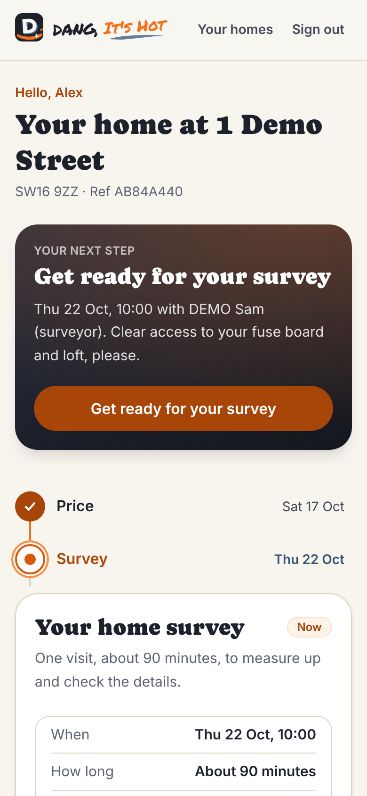
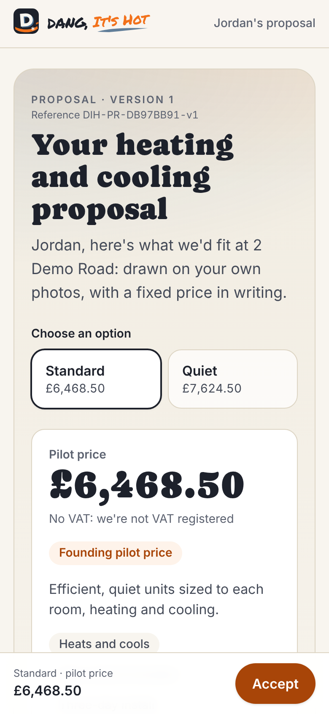
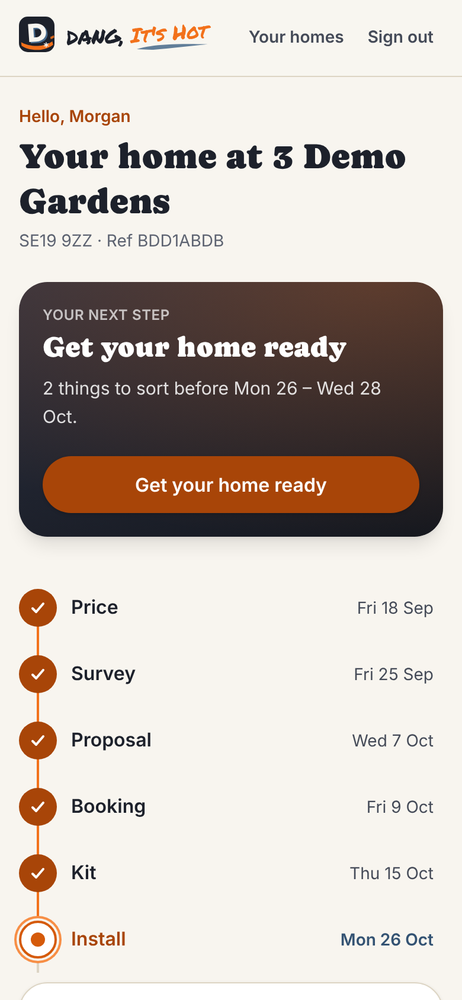
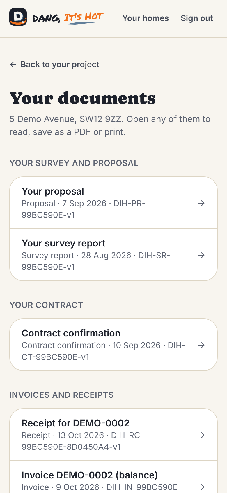

# The customer journey: what families see, and every message they get

What a pilot family sees on their project page at each stage, what they're
asked to do, and every email and text the app sends them, with when and
why. The message list comes from the app's own message catalogue
(`COMMS_EVENTS` in `packages/domain/src/comms.ts`) and the daily schedule
(`apps/web/lib/ops-core-schedule.ts`). Every picture is fictional DEMO data.

## How families get in

- **No passwords.** Every email we send carries a **Sign in** button that
  opens their own project page. A link from an email works once and lasts
  30 days. Clicking it shows "Continue as j\*\*\*@…" first, so nothing
  happens by accident.
- Lost the email, or the link ran out? They go to your site's `/portal`
  page (or their project page), type their email and press **Email me a
  sign-in link**. That link lasts 60 minutes. Or you send them one: the
  project → **Admin** box → **Email them a sign-in link** (30 days).
- **Every sign-in email also has a 6-digit code** ("Signing in on another
  browser … type this code"). A link tapped in the Gmail or Outlook app
  opens in that app's own browser, so they'd be signed in there; instead
  they type the code on the page where they asked for the link, under
  **Enter the 6-digit code from the email** (or on `/portal` under
  **Already have a code from a sign-in email?**, with their email). The
  code works once, for 15 minutes (even in a 30-day email), only for that
  address, and only the newest email's code works; using the code or the
  link uses up both. Five wrong tries rest that address's codes for a
  quarter of an hour (the link still works). The links inside our other
  emails (proposal, booking, invoices) carry no code.
- Their email address is their identity: they only ever see their own home.
- **Your homes** (`/portal`) lists every home they have with us.

## The project page

Every family sees the same layout, on a phone or a computer:

1. **Hello, \<first name\>** and the address, with a short reference (e.g.
   "Ref AB84A440"). Quote that reference, not their name, when you talk to
   anyone outside the business.
2. **Your next step**: always exactly one thing to do, or "Nothing for you
   to do right now".
3. **Your project, stage by stage**: eight stages (Price, Survey, Proposal,
   Booking, Kit, Install, Handover, Aftercare), done ones dated, future ones
   with an estimated date.
4. **Updates**: everything that's happened, newest first.
5. **Payments** (once there's a contract) and **Your documents**: proposal,
   contract, invoices, receipts, certificates and the handover pack. Each
   opens as a page they can save as a PDF or print.
6. **Questions? Talk to us**: the phone and email from Settings.

## Stage by stage

### 1. Price

**How it starts.** You set them up with **New pilot** and tick **Email them
a link**. (A family who came through the website's quote form starts here
too, with their instant price.)

**They see:** their instant price ("confirmed at your survey") and **Book
your home survey**.

| Message | Channel | When |
| --- | --- | --- |
| **Your link to your Dang, It's Hot project** | Email | When you set up the pilot with the box ticked |

### 2. Survey

**They do:** pick a slot (or see the one you booked). Moving it is free.
**Before we arrive** lists: clear access to the fuse board, loft access,
think about where the units could go, someone 18 or over at home.

| Message | Channel | When |
| --- | --- | --- |
| **Your home survey is booked: \<day, time\>** (or **…has moved to …**) | Email | The moment it's booked or moved, by them or by you. You also get a team alert when they book it |
| **Reminder: your home survey on \<day, time\>** | Email and text | The day before, at about 4pm (5pm in summer) |
| **Your surveyor is on the way** | Text (email if no mobile, or if texts aren't set up) | When the surveyor taps On my way, with their arrival time |
| **Thanks for having us: your survey is done** | Email | When the surveyor submits the survey. Gives the date to expect the proposal: 3 working days later |

During the survey the surveyor asks whether they're happy to get their
proposal and contract documents by email. That agreement is needed before
any proposal can be issued. If they didn't agree, the survey email asks
them to (tick the box under Proposal on their page, or reply if they'd
rather not), and their next step says **Agree to get your documents by
email**. The pilot can't send documents on paper, and nothing promises it:
if they'd rather not use email, the office calls them to talk it through.
If the promised date passes while it waits on their agreement, their page
says it's waiting for that, not that we're late.

### 3. Proposal

**They see:** **Review your proposal**. The proposal page shows their own
room photos with each unit drawn on them, why each size, the outside unit,
how the pipes run, what's included and not, the three-day plan, the price
(with the pilot discount as its own line), how and when to pay, the
guarantees, and the full terms. With two options, a switch between
Standard and Quiet.

**They do:** **Accept this proposal** (choose the option; read the
cancellation information and model form and tick that they have; choose
whether to start within the cancellation period; type their full name; **I
accept and agree to pay £X**), or **Ask for changes**, or nothing.

| Message | Channel | When |
| --- | --- | --- |
| **Your proposal is ready** (or **Your updated proposal is ready (version 2)**) | Email | When you issue it. This is the legal copy of the pre-contract information, the cancellation instructions and the model cancellation form |
| **Your proposal is valid until \<day\>** | Email | Once, 3 days after it was issued, if they haven't answered |
| (The proposal expires) | None | On its "valid until" date, if still unanswered |
| **Changes requested: \<name\>** | Email to the team | When they ask for changes, with what they said |
| Team alert: the proposal is late | Email to the team | The day after the date we promised, then every 3 days until it's issued. Their page apologises instead of showing the old date |

### 4. Booking

**They see**, after accepting: the acceptance confirmed, **What happens
next**, their cancellation period, and **Choose your install dates** (they
can pick, or you set them). If they asked to start early: **Reply to
confirm your early start**, with the exact words to send.

| Message | Channel | When |
| --- | --- | --- |
| **Your contract with Dang, It's Hot: confirmation and cancellation rights** | Email | Straight after they accept: the contract, their cancellation position and form, how to confirm an early start by replying, and how to choose dates. You also get a team alert |
| **Invoice \<number\>: £X due \<day\>** | Email | If there's a deposit, when you send the deposit invoice |
| **Payment received: £X, thank you** | Email | When a payment is recorded (bank transfer seen by you, or a card payment confirmed by Stripe) |
| **Your install is booked: \<dates\>** (or **Your install dates have changed: …**) | Email | When you confirm the booking, and whenever the dates move after that. Dates, the team, and the prep list |

**The cancellation period.** Because we supply the equipment, they can
cancel until 14 days after the last of it arrives. We don't start inside
that time unless they've asked in writing (their reply to the contract
email). Their page shows the exact end date once the kit is delivered,
and an email (**Your cancellation period: you can cancel until …**) gives it
to them that day. Kit we hold ourselves (our store, the installer, a
subcontractor) reaches them with the crew, so for that kit the period starts
on install day 1.

### 5. Kit

**They see:** "Your kit is ordered", then each real step. Never a guessed
delivery date.

| Message | Channel | When |
| --- | --- | --- |
| **Your equipment is confirmed by the supplier** | Email | When the supplier confirms a date |
| **Your equipment has been delivered** | Email | When the delivery to their home is recorded. Their cancellation period now has an end date |
| **Your equipment has arrived with our team** | Email | When the kit reaches our store, the installer or a subcontractor instead (never "delivered"). It says their cancellation period starts on the day the kit is brought to their home |
| **Your equipment has been checked** | Email | When the kit is checked against the design (by the office or the installer) |
| **Your cancellation period: you can cancel until \<date\>** | Email only, never a text | Supply and install, on the day the period starts: the kit is delivered to their home, or (kit we held) install day 1. The exact last day they can cancel without a reason, how to cancel, and (if they asked us to start early) that work done may be charged for. Sent once; not after that last day, nor on a closed or cancelled project |

### 6. Install

**They see:** **Get your home ready** (the prep list to tick: clear space
under each unit, parking for a van, someone 18+ at home), the plan day by
day, the power-off warning (up to 30 minutes on day 2), **Your install
team** with names, photos and the certificates they actually hold, and the
end-of-day updates as they arrive. When the office sends a change for
their OK, their next step (on the page and on **Your homes**) becomes
**Answer a change to your installation** with the change and its price,
and its button opens the change to answer, until they've said yes or no.

| Message | Channel | When |
| --- | --- | --- |
| **Getting ready for your install on \<day\>** | Email | 3 days before day 1 (or the next day's run, if that was missed): the prep list still to tick and the power-off warning |
| **Your install starts \<day\>** | Email and text | The day before day 1, at about 4pm (5pm in summer): arrival, who's coming, parking |
| **Your installer is on the way** | Text (email if no mobile, or if texts aren't set up) | When the installer taps On my way, each morning they do. One that can't go within 45 minutes (or by the arrival time it gives) is never sent late, and no reminder goes once the survey or install has started, or for a closed or cancelled project |
| **Your install: day 1 of 3 done** | Email | When the installer ends the day with an update: what's done, what's next, and the 2 to 4 photos they picked |
| **A change to your installation needs your OK** | Email and text | When the office sends a variation for their approval. They approve or decline on their page |
| **You agreed a change to your installation** | Email | When they approve it: what changes, the price, the record of their yes |
| **Update: \<title\>** | Email | When you send an update on a problem or snag by hand |

### 7. Handover

**They see:** the walkthrough on the installer's phone, then **All good**
or **There's a snag**, their name and signature. Afterwards the handover
pack and certificates in **Your documents**.

| Message | Channel | When |
| --- | --- | --- |
| **Your handover pack is ready** | Email | When the crew publishes it (after commissioning is signed): equipment and serial numbers, commissioning certificate, manuals, warranty, care guide, contacts |
| **Invoice \<number\>: £X due \<day\>** | Email | The balance, when you issue it after the installation is finished. Due in 7 days by default |
| **Payment received: £X, thank you** | Email | When the balance is recorded |
| **Your electrical certificate is in your documents** | Email | When you add the electrician's certificate (if the pack was already out) |
| **Your manufacturer warranty is registered** | Email | When you record the warranty registration (if the pack was already out) |

### 8. Aftercare

**They see:** first service due (12 months after handover), the warranty
status, their feedback, **Report a problem** (goes straight to the team,
with photos if they add them; anything urgent or unsafe they say at the top,
and we call them first), and **Stop follow-up emails**.

| Message | Channel | When |
| --- | --- | --- |
| **How's your system running?** | Email | 7 days after handover (sent up to day 21 if the daily run was missed) |
| **One month on: how did we do?** | Email | 30 days after handover (up to day 60): a 0 to 10 score and three questions, for us only. Sent to everyone, whatever they'd say |
| **Would you review Dang, It's Hot?** | Email | 37 days after handover, a week after the feedback request, and only once the electrical certificate and warranty registration are done and a **Review page link** is set in Settings. Same words for everyone, no incentive, never depends on their score |
| **Colder days ahead: using your system to heat** (or **Warmer days ahead…: to cool**) | Email | Once, at the first change of season: from 1 October after a spring or summer handover, from 1 June after an autumn or winter one, never within 28 days of handover |
| **Your system's yearly service is due \<day\>** | Email | Once, about 30 days before the service date (12 months after handover): the date and the warranty condition. The offer to book it only if they agreed to marketing |

These five are the follow-up emails. Each has an opt-out line, and none goes
to a family who pressed **Stop follow-up emails** or who cancelled.

## Any time

| Message | Channel | When |
| --- | --- | --- |
| **We've received your cancellation** | Email | When you record their cancellation: when it reached us, the refund and its deadline, collecting any equipment |
| **Update: \<title\>** | Email | When you send an issue update by hand |
| A fresh sign-in link | Email | When they ask for one on `/portal`, or you press **Email them a sign-in link** on their project |

## Messages to the team

| Message | When |
| --- | --- |
| The morning email | Every day at 6am (7am in summer): today's visits, what's blocked or overdue, money owed, yesterday's website enquiries |
| Team alerts | When a family books a survey, accepts, asks for changes, pays, raises something urgent; when a message fails; a weekly reminder while an electrical certificate is overdue; when a proposal is later than we promised |

They go to the `LEADS_NOTIFY_EMAIL` inbox (or the `EMAIL_FROM` address if
that isn't set).

## Timing and channels: the rules

- **The daily run** sends the reminders, nudges and aftercare emails once a
  day at 16:00 UTC: 4pm in winter, 5pm in summer (UK time). Admins can also
  press **Run daily jobs now** on the Messages page. Every message is keyed
  to its occasion, so nothing is ever sent twice.
- **Everything else is sent the moment it happens** (a booking, an issued
  proposal, an end-of-day update).
- **Texts** go only for the survey and install reminders, on-my-way, and a
  change needing approval. They're from the sender name `DangItsHot`, which
  can't receive replies, so every text gives your phone number and says
  "Texts to this number aren't read". Until Twilio is set up, texts are
  recorded as "Demo, not sent" and families still get every email.
- **Replies to emails** go to the company email in Settings.
- **A message that fails** shows in red on the Messages page and is retried
  on the next daily run, or straight away with **Retry**.
- **Website enquiries that weren't finished** (not the pilots) get one
  friendly reminder email between 24 hours and 7 days after they stopped,
  sent at 10:00 UTC, and never another, but only if they left **Email me
  one reminder if I don't finish** ticked under the email on the form's
  first step (at most 10 a day). It says why it came and how to have the
  quote deleted.
