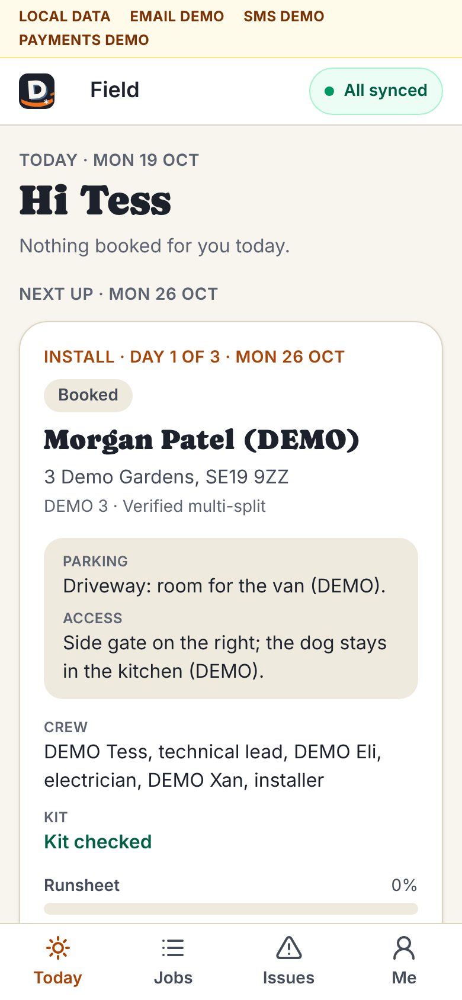
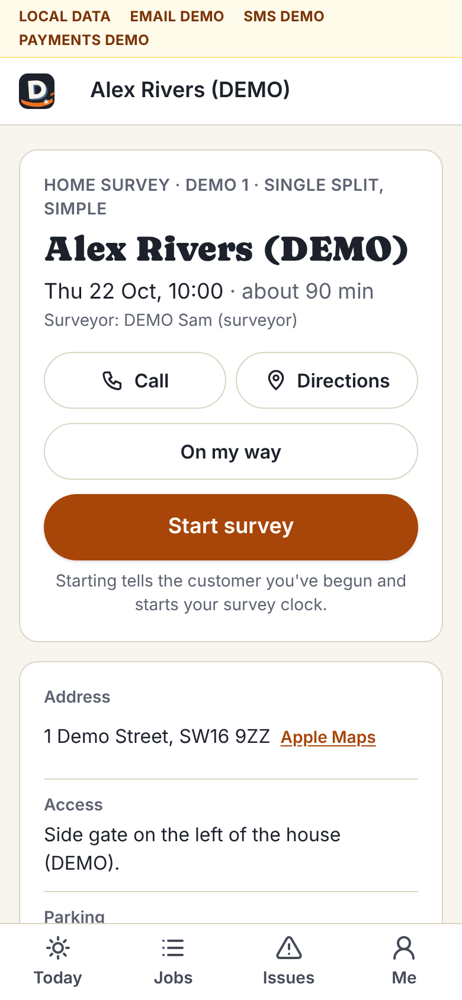
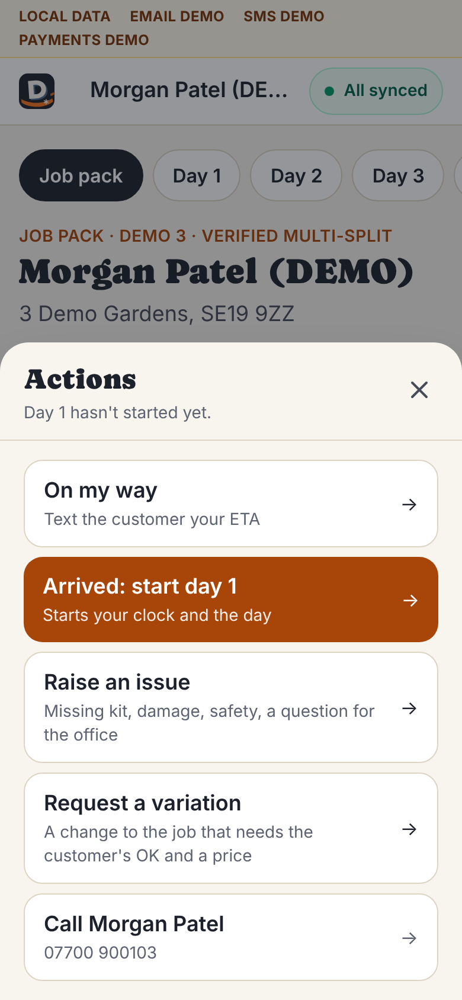
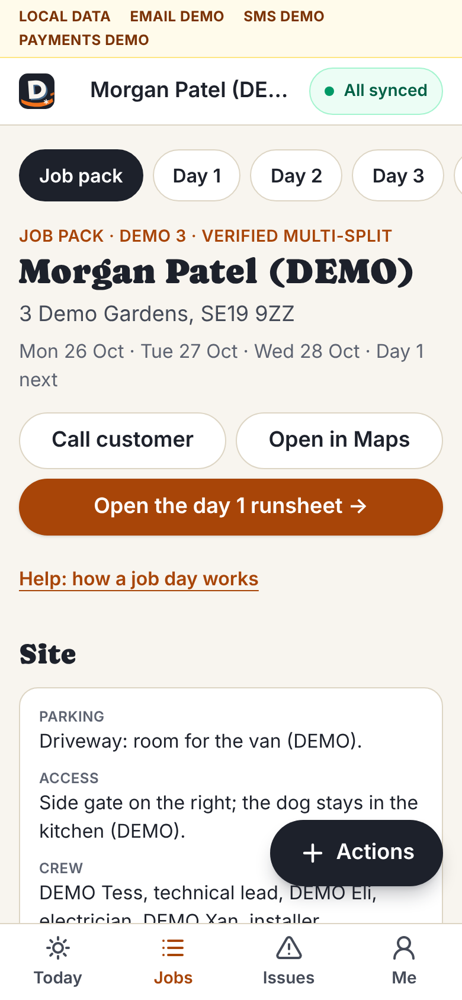
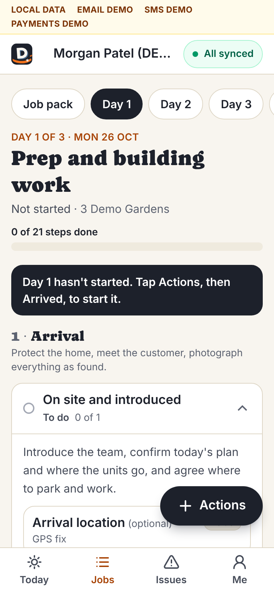

# Field guide: surveyors, installers, the electrician and the technical lead

For everyone who works in people's homes. The app's own short version is
on your phone under **Me → Help: how a job day works** (`/field/help`); this
is the longer one. Every picture here is fictional DEMO data.

## Contents

1. [Getting in](#1-getting-in)
2. [Your four tabs](#2-your-four-tabs)
3. [The sync badge](#3-the-sync-badge-top-right)
4. [Surveyors: the home survey](#4-surveyors-the-home-survey)
5. [Installers: a job day](#5-installers-a-job-day)
6. [Evidence, outcomes and locked steps](#6-evidence-outcomes-and-locked-steps)
7. [Issues and variations](#7-issues-and-variations)
8. [End of day](#8-end-of-day)
9. [The electrician](#9-the-electrician)
10. [The technical lead: design, checklist, commissioning](#10-the-technical-lead)
11. [Handover with the family](#11-handover-with-the-family)
12. [Safety and who to call](#12-safety-and-who-to-call)

---

## 1. Getting in

1. The office adds you on **Staff** with your email, your role, and your
   certificates (F-gas, Part P) with a photo of each.
2. On your phone, open the site's `/login` page, type your email in **Work
   email** → **Email me a sign-in link**.
3. Open the email on the same phone → **Sign in** → **Continue as …**. The
   link works once, for 20 minutes.
   - The email also has a **6-digit code**. If the link opens inside your
     email app (Gmail and Outlook open links in their own browser, so
     you'd be signed in there, not in Safari or Chrome), go back to the
     sign-in page in the browser you want instead: under **Enter the
     6-digit code from the email**, type it → **Sign in with the code**.
     The code works once, for 15 minutes, and only for that email address.
     Using the code or the link uses up both. If you asked for two emails,
     only the newest one's code works.
   - Already on the sign-in page with a code and nothing on screen? Open
     **Already have a code from a sign-in email?**, type your email and the
     code.
4. **Add the field app to your Home Screen.** Once you're signed in, open
   **Today** (`/field`), then on an iPhone **Share** → **Add to Home
   Screen** (in Chrome on Android: the menu → **Add to Home screen**). The
   icon opens the field app full screen. It has its own sign-in, separate
   from the browser's, so the first time you open it you sign in there:
   type your email → **Email me a sign-in link**, read the code in your
   email app, come back to the icon and type the code. Never tap the link
   for this: a link always opens the browser, not the Home Screen app.
   A sign-in lasts 30 days and renews itself as you use the app (once
   it's more than halfway through, opening any page with signal gives it
   another 30 days), up to 90 days after you signed in; then sign in again.
   **Me** says until when, and the latest it can go on to.

Subcontractors only ever see the jobs they're on: no prices, no margins,
no other families. On the crew's phones (installers, the electrician and any
subcontractor) the family's own pages, with their prices, contract and
invoices, stay closed; the commissioning certificate and the handover pack
open from the job.

## 2. Your four tabs

Along the bottom of every field screen:

- **Today**: what's booked for you today, then **Next up**. Each card has
  the address, parking and access notes, the crew, the kit status, and
  **Call**, **Maps** and **Open job** (or **Open survey**).
- **Jobs**: every job you're on.
- **Issues**: issues raised on your jobs, and their status.
- **Me**: your name and roles, **What you can sign off** (F-gas, Part P,
  technical lead: Yes or No), your qualifications and expiry dates, **Help**,
  and **Sign out**.

If **What you can sign off** says No for something you hold, tell the
office: they need to upload and tick your certificate.

## 3. The sync badge (top right)

Everything you do saves on the phone first, then sends by itself.

- **All synced**: everything is safe on the server.
- **3 waiting to sync**: saved on the phone, sending now.
- **Offline · 3 waiting**: no signal. Keep working; it sends when you're
  back in signal.
- **1 needs attention** (red): something was turned down. Tap the badge to
  see what and why, then fix it or tell the office.
- **Keep open · 3 waiting** (red): the phone's storage didn't take these
  (a private tab, storage full, or the browser dropped it). They're only in
  this page: keep it open and get signal until it says **All synced**. The
  capture itself says **Not kept on phone: keep open**.

Tap the badge any time for the list and **Sync now**. While anything is
waiting, don't clear the browser's data or switch to a private tab: it lives
on that phone until it's sent.

**Lending your phone.** Every capture is saved under the person who made
it, and only sends while they're signed in on that phone. Sign out with
something still waiting and it stays on the phone, under your name, until
you sign in there again; if a colleague signs in on it meanwhile, your
captures wait for you (the badge's list says "Captured by …"), and theirs go
under their name. The **Me** page warns before you sign out with anything
waiting and offers **Sync now**: use it when you can.

Photos and videos upload on their own, so readings, issues and clock taps
never wait behind a slow upload.

**These need signal**, because the server checks them: starting a day,
ending a day, the "on my way" text, commissioning sign-off and the
handover sign-off. Step outside or try again in a minute.

## 4. Surveyors: the home survey

About 90 minutes. Bring a laser measure, a compass app, a ladder for the
loft hatch, and a torch for the fuse board.

1. **Today** → the visit → **Open survey**. You see the address, access and
   parking notes, and **What they told us** (the family's own answers).
2. Setting off: **On my way** → pick an arrival time → check the text →
   send. (No signal: **Call them instead**.)
3. On site: **Start survey**. It tells the family you've begun and starts
   your survey clock.
4. Work through each section. It saves as you go, signal or not, and
   **Next** walks you through in order:
   1. **Site & people**: address confirmed, who decides, owner (or authority
      to go ahead) confirmed, own or rent.
   2. **Wishes**: heating as well as cooling, or cooling only; what matters
      (quiet, discreet, app control, budget); timing.
   3. **House**: construction, era, loft access. Older homes get the
      asbestos questions: suspected asbestos means stop and raise it.
   4. **Rooms**: for each room, the measurements, windows and sun, and a
      **tagged photo** with the unit drawn where it would go (tools: indoor
      unit, core hole, pipe route, condensate, cable, obstacle,
      measurement). Then the pipe route to outside with its measured length
      and height drop, and whether the condensate drains by gravity or needs
      a pump.
   5. **Outdoor**: a photo with the unit drawn on it, distance to the nearest
      neighbour's window (to a point 1 m out from the centre of their nearest
      habitable-room window or glazed door: MCS 020(a)'s assessment
      position), **Hard surfaces within 1 m of the unit** (the ground counts:
      one, two against a wall, three in a corner or side return), base or
      bracket, access equipment, where defrost water will go.
   6. **Electrics**: fuse board photo, spare ways, earthing, cable route and
      length, and the old-board asbestos check.
   7. **Permissions**: the permitted-development questions for the outdoor
      unit (size, position, listed or conservation area).
   8. **Risks**: working at height, hidden services, pets, anything else.
   9. **Assumptions & unknowns**: anything you couldn't check.
   10. **Documents by email**: ask "Are you happy to receive your proposal
       and contract documents by email?" and record it only if they say yes.
       Without it no proposal can go: the pilot can't send documents on
       paper. If they'd rather not, tell them the office will get in touch
       to talk it through (the office sees it on the project).
5. **Check and submit** lists anything missing. **Submit survey** sends it
   to the technical lead. You can't edit it afterwards.

The family gets "Thanks for having us" with the date their proposal will
arrive (3 working days).

## 5. Installers: a job day

The big **Actions** button (bottom right on every job) does most of it.

**The night before**

1. **Today** or **Jobs** → the job → **Job pack**: the address, parking and
   access, the crew, the kit status, and:
   - **RAMS**: read them and tap **I've read the RAMS and the risks**.
     Everyone on site does this.
   - **The approved layout**: each room's photo with the unit, core hole,
     pipe route and condensate drawn on it, signed off by the technical
     lead. Follow it. If the wall isn't what the drawing shows, raise an
     issue before drilling.
   - **Materials** (what to load, from the purchase orders) and **Tools**
     (the standard kit plus what this job needs).
   - **What the customer asked for** and the **Scope of work**.

**The day**

1. Setting off: **Actions** → **On my way** → pick 20, 30, 45 or 60 minutes
   (or type one) → check the text → **Send**.
2. On site: **Actions** → **Arrived: start day 1** (or 2, or 3). That starts
   the day and your clock. If it won't start, the screen says why (for
   example the kit isn't checked, or the checklist isn't approved): sort it
   or call the office. Joining a day someone else started: **Arrived: start
   my clock**.
3. Work down the day's runsheet (the **Day 1**, **Day 2**, **Day 3** tabs).
   For each step, capture its evidence, then mark it (§6).
4. Breaks or a supplier run: **Actions** → **Pause**. Back: **Resume**.
5. Leaving: **Actions** → **End day 1** (§8).

The three days, roughly:

| Day | What |
| --- | --- |
| 1 · Prep and building work | Arrival, protection, condition photos, RAMS, kit and serial check, marking out (scan the wall first), core drilling, wall plates, outdoor base or bracket |
| 2 · Mechanical and electrical | Indoor units, outdoor unit, pipework, flares and torque (F-gas), condensate, the electrical circuit (electrician) |
| 3 · Test, commission, hand over | Pressure test, vacuum, release and leak check (F-gas), commissioning in heating and cooling, electrical tests, walkthrough, paperwork, finished photos, clean up |

## 6. Evidence, outcomes and locked steps

**Evidence.** Each step has slots: photos, readings, serial numbers,
signatures, confirmations. Fill every one it asks for, then tap **Pass**.

- Photos: the whole item in shot, the label readable for serials, nothing
  in the way.
- Readings: record what you actually measured. A reading outside its
  allowed range is flagged **Needs review** for the technical lead. Never
  re-take a reading to make it pass. (The pressure test and the vacuum are
  judged as a whole instead: below.)

**The pressure test and the vacuum** (day 3, F-gas):

- *Strength and tightness test.* Oxygen-free nitrogen at the manual's test
  pressure, never above the outdoor unit's nameplate PS. Type the pressure
  you applied and the ambient temperature by the pipework; hold for the
  manual's time; then type the pressure and the temperature at the end, how
  long it held, and your gauge's **resolution** (the smallest step it reads:
  0.1 bar on most digital manifolds). Photograph the gauge.
- The app judges it from those readings. It corrects the end pressure to the
  start temperature in absolute terms (end + 1.013 bar, × start K ÷ end K,
  − 1.013 bar: a cooler afternoon lowers the gauge without a leak, a warmer
  one can hide one) and fails the test if it fell by more than the gauge's
  resolution, or the manual's allowance if the technical lead set one.
  Testing above PS or below the manual's pressure, or holding for less than
  the manual's time, fails too.
- *Vacuum and decay test.* Digital micron gauge, not the compound gauge.
  Pull down to 500 micron (66.7 Pa), or the manual's figure if it's
  stricter; isolate the pump; hold for the manual's time; type the reading
  after. A rise above the job's limit fails: moisture or a leak.
- **A failed test is found, fixed and done again, with every reading taken
  again.** Typing one reading again or tapping **Pass** doesn't clear it, the
  technical lead can't accept it, and a target changed afterwards doesn't
  pass it either: commissioning can't be signed until a retest passes. A
  reading that can't be right (a 150 °C ambient) just waits to be typed
  again. The step shows the readings, the correction and the result, and so
  do the commissioning certificate and the family's handover pack.

**Outcomes**

| Outcome | When | Needs |
| --- | --- | --- |
| **Pass** | Done, and every slot captured | Nothing more |
| **Fail** | Done, but the result is wrong (a joint that bubbles, a pump that won't discharge). A pressure or vacuum test that fails on its readings is marked failed for you | What happened. A failed critical step stops the job until the technical lead looks |
| **Blocked** | You can't do it (no access, a missing part, not safe) | Why. It raises an issue for the office |
| **N/A** | It doesn't apply to this job (no condensate pump on this one) | Why |

A few words is enough: the office and the technical lead read every one.

**Locked steps.** Steps marked **F-gas**, **Electrician** or **Tech lead**
show "locked" unless you hold that qualification, in date and checked by the
office (see **Me**). You can still mark them Blocked. Never do refrigerant
or electrical work you're not certified for.

## 7. Issues and variations

**Raise an issue** (**Actions** → **Raise an issue**): missing kit, damage,
safety, a question for the office, a customer request, anything that stops
you. Pick what kind and how serious, add a title, details and a photo. Tick
**This stops the job** if it does → **Raise it**.

> **Safety first.** Stop work in that area, raise it as Safety, and call the
> office. Suspected asbestos is never drilled.

**Request a variation** (**Actions** → **Request a variation**) when the
customer asks for more, or the job needs something that isn't in the scope:
a longer pipe run, a pump, a unit moved. Write **The change, in a few
words**, **Why it's needed (the customer reads this)**, and an **Estimated
price change, £ before VAT** → **Send to the office**.

> **Then wait.** The office checks the price, the family approves or
> declines it on their page, and its status shows under **Issues**. Never do
> unapproved extra work: it isn't in their contract.
>
> **A change over £42 has its own 14 days to cancel**, like the contract
> (until a solicitor tells us otherwise). Even approved, its card says
> **don't start it** until the family has asked in writing for the work to
> start now (they reply to the change's email; the office records it) or
> the 14 days are over. Start it only when the card says **go ahead**. If
> they'd rather keep their 14 days, the office books a return visit.

## 8. End of day

1. **Actions** → **End day 1** (the button shows today's day number).
2. Check the summary of what's done and what's next. It's written for the
   family.
3. Pick 2 to 4 photos of finished work. Only the ones you pick are shown to
   them (never photos from an issue). The newest 24 show first, to spare
   your data; **Show more photos** brings in older ones.
4. **Preview the update**, then **End day 1 and send**. Nothing to tell
   them today? **End day 1 (no customer update)**.
5. Two minutes of questions: what took longer, what was missing, what tool
   would have helped, what confused the customer. Optional, but it's how
   the next job goes better.

Ending the day stops your clock. It needs signal. If someone else on the
crew has already ended the day from their phone, yours says so, sends no
second update and still stops your clock.

## 9. The electrician

- You're added on **Staff** with the **Electrician** role and your **Part
  P competent person scheme** membership (number, expiry, a photo of the
  card or certificate, checked by the office). Without it the electrical
  steps stay locked and no booking can be confirmed.
- Your steps are on **Day 2** (**7 · Electrical**: the new circuit, the
  breaker, terminations, tests) and **Electrical certificate** on **Day 3**.
  They're marked **Electrician** (and the circuit **Critical**), and locked
  for anyone without Part P.
- Warn the family before switching off: the power is off for up to about 30
  minutes. Their project page already tells them to expect it.
- The **electrical installation certificate** and the scheme's Building
  Regulations notification: send them to the office as soon as you have
  them. The office uploads the certificate to the family's documents; the
  law gives 30 days from completion, and the office is reminded weekly
  while it's late.

## 10. The technical lead

You need the **Technical lead** role and a current, checked **F-gas
Category I** certificate. Your work is partly at a desk (the office pages
open on your account too) and partly on site.

**Design approval** (desk). The project → **Open the design**. Check each
room's suggested size (a rule of thumb, not a heat-loss calculation), pick
the size, confirm the outdoor unit, the pipe runs and condensate, and look
at every **CHECK** light: planning, noise at the nearest neighbour (an
estimate against the 37.0 dB(A) MCS 020(a) leaves the heat pump, with no
barrier credit; the full MCS 020(a) calculation is yours), **Room size for
the R32 charge** (over 1.84 kg in one system, every room it serves needs the
manual's minimum floor area: the app uses the IEC 60335-2-40 formula and
blocks approval when a room is too small or not measured; check the
manual's own table), mounting, access, catalogue data.
Multi-split only from a combination the catalogue marks verified. Then
**Approve and sign**: that locks the layout photos the crew works from.

**The compliance checklist** (desk). The project → **Open the checklist** →
each item → **Review** → **Approve** or **Not applicable**, with a note →
**Save the review**. Statutory items can't be skipped.

**On site.** The F-gas steps (flares and torque, pressure test, vacuum,
release and leak check) are yours or another F-gas holder's. Anything a
crew member flags **Needs review** comes to you; an ordinary installer can't
clear it.

**Commissioning** (the job's **Commission** tab, on the last day):

1. **This job's targets**: the manufacturer figures weren't verified in our
   research, so you set each one from this model's installation manual:
   nitrogen test pressure (the manual's figure as the minimum, the outdoor
   unit's nameplate PS as the maximum), the pressure test's hold time and
   allowed fall (**Use the gauge's resolution** unless the manual gives a
   figure), the vacuum target (**Use 500 micron** unless the manual's is
   stricter), the vacuum decay hold time and rise limit, the highest
   reading after the hold if the manual gives one, flare torque for each
   pipe size, condensate fall. Type the figure and the manual page → **Set
   target**. Readings already taken are judged against what you set; a
   change that would pass a test that already failed leaves it failed,
   owing a retest.
2. **Ready to sign?** lists what's left: unfinished steps, a failed
   pressure or vacuum test still to retest, targets not set, readings to
   review, and anything for this job still on your phone (the
   certificate is made from what the server has, so **Sign** waits for it to
   sync: **Sync first**).
3. Review every **Needs review** reading.
4. **Sign as \<your name\>**. That completes the install and issues the
   commissioning certificate. It can't be undone from the field. If a
   reading arrived from another phone since your screen loaded, signing is
   refused and names it: check the results again, then sign.

## 11. Handover with the family

The job's **Handover** tab, with the family beside you.

1. **Walkthrough**: let them press the buttons, and tick each as you show
   it: modes and the remote (including heating), the app paired on their
   phone, cleaning the filters, where the condensate goes, normal sounds,
   drips and defrost steam, where the isolator is, the manufacturer's
   manuals handed over.
2. **Publish the handover pack** (once commissioning is signed): their
   equipment and serial numbers, certificates, manuals, care guide and
   contacts appear in their documents. The sign-off opens as soon as it
   says **Published**. If it says there was no reply, tap **Publish
   again** when you have signal: it never publishes (or emails) twice.
3. They pick **All good** or **There's a snag** (write each snag down), type
   their name and sign → **Sign off the handover**. Each snag becomes an
   issue with an owner and a date, and they can see it.
4. Then end the day as usual (§8).

## 12. Safety and who to call

- **Anyone hurt, fire, an electric shock, anyone in danger:** 999 first,
  then the office.
- **The office**, for anything else: stuck, unsure, a customer problem.
  The office number is on **Me → Help**, under **Who to call** (once it's
  in Settings).
- **The technical lead** on the job, for readings, F-gas and design
  questions: their name is under **Crew** in the job pack.
- **The family**: on the job, **Actions** → **Call** and their name.
